# SERIES SOWER ENGINE — MASTER OPERATOR'S MANUAL

> **Deterministic Edge Simulation Runtime & Four-Vector Storyworld Engine**  
> Monorepo Workspace: `packages/300.engine` | Cockpit UI: `apps/995.library`  
> Canonical Reference Guide synthesized from Directives `001` through `009`.

---

## 1. System Overview & The Fundamental Law

The **Series Sower Engine** (`series-sower-engine`) is an event-sourced, local-first simulation and storyworld runtime designed for deterministic world execution, automated multi-agent governance, and reproducible narrative generation.

It operates on a dual-plane architecture:
1. **The Blessed Terminal Cockpit (`apps/995.library` & `packages/300.engine/98.menu.unit`):** A curses-based operator interface providing real-time diagnostics, panopticon projections, and interactive controls.
2. **The Deterministic Simulation Kernel (`packages/300.engine`):** A modular, unit-colocated TypeScript engine executing on local SQLite persistence with zero cloud isolate overhead.

```mermaid
graph TD
    subgraph Cockpit ["Terminal Cockpit (apps/995.library / 98.menu.unit)"]
        UI["Blessed Curses Interface"]
        CNS["Telemetry Console (cns00)"]
    end

    subgraph Kernel ["Simulation Kernel (packages/300.engine)"]
        Srs["15.series.unit<br/>(Namespace Routing)"]
        DB["02.database.unit<br/>(SQLite 4-Vector Tables)"]
        Prm["13.primordial.unit<br/>(Genesis S_0 Bootstrapper)"]
        State["16.state.unit<br/>(4-Vector Panopticon)"]
        Trm["18.trauma.unit<br/>(Somatic Biomechanics)"]
        Wnd["19.wounds.unit<br/>(Kinetic Verb Masks)"]
        Inv["07.inventory.unit<br/>(Hand Capacity & Slots)"]
        Mov["11.movement.unit<br/>(Axial Hex Math)"]
        Loc["10.location.unit<br/>(Room Capacity & Portals)"]
        Tck["17.tick.unit<br/>(HMAC Logical Clocks)"]
        Ledger["08.ledger.unit<br/>(StagingAccumulator)"]
        Env["04.envelope.unit<br/>(RFC 8785 Hash Sealer)"]
        Evt["05.event.unit<br/>(Read-Time Upcaster)"]
    end

    UI --> Srs
    UI --> DB
    UI --> Prm
    UI --> State
    UI --> Trm
    UI --> Inv
    UI --> Mov
    UI --> Tck
    UI --> Ledger
    UI --> Env
    UI --> Evt
    Kernel -.-> CNS
```



### The Core Invariants of the Engine
- **Bit-Exact Determinism:** Every simulation state transition is a pure mathematical function of the prior state and an explicit event envelope.
- **Float Prohibition (`[FLOAT_PROHIBITED]`):** Floating-point numbers are structurally forbidden in simulation logic. All fractions, probabilities, and health meters are strictly expressed in integer basis points ($1\text{ bps} = 0.01\%$, $10,000\text{ bps} = 100.00\%$), preventing cross-platform V8/JSC rounding divergence.
- **Absolute Wall-Clock Independence:** System clocks (`Date.now()`) are untrusted. Time progresses strictly in discrete logical ticks, deriving pseudo-random entropy via HMAC-SHA256 seeds.
- **Append-Only Immutability:** Historical event rows in `event_log` are sealed into cryptographic SHA-256 hash chains guarded by database triggers. History is never mutated in-place.
- **Zero-Cost Abort ($T_0 = \$0.00$):** Invariant breaches (e.g. attempting to hold two items with one arm or moving into an overcrowded room) are halted at the SQLite schema or synchronous TypeScript gate level in $< 2\text{ms}$ before any AI/LLM tokens are spent.

---

## 2. The Four-Vector State Model

The engine represents physical and psychological reality through four tightly coupled, materialized vectors codified in [packages/300.engine/16.state.unit/fce/state.interface.ts](file:///d:/trellis/000.series-sower-engine/packages/300.engine/16.state.unit/fce/state.interface.ts):

| Vector | Focus Domain | Key Tables / Inodes | Mathematical Invariants |
| :--- | :--- | :--- | :--- |
| **1. Somatic** | Physical body, wounds, fatigue, pain, kinetic capability | `entities_live` (`arms_available`, `legs_available`, `locomotion_tier`, `open_wounds_json`, `banned_kinetic_verbs_json`) | Pure integer basis points $[0, 10000]$; Banker's Rounding; $O(1)$ set-intersection verb masking. |
| **2. Logistical** | Physical items, gear, carriage limits | `entities_live` (`held_items_json`, `worn_gear_json`, `slung_items_json`, `cached_items_json`) | **Hand Capacity Law:** $\text{count}(\text{held\_items}) \le \lfloor\text{arms\_available}\rfloor$; mass conservation across ejections. |
| **3. Spatial** | Topology, hex coordinates, room volume | `entities_live` (`coord_q`, `coord_r`), `10.location.unit` | **Axial Cubic Invariant:** $q + r + s = 0$; non-Euclidean hex distance; room occupant capacity ceilings; portal occlusion. |
| **4. Relational / Epistemic** | Leverage, grievances, paranoia, subjective beliefs | `strings_ledger`, `grievance_status`, `paranoia_clocks`, `actor_beliefs` | Anti-reflexive constraints (`holder != debtor`, `instigator != victim`); integer basis-point decay per tick. |

---

## 3. Cockpit Navigation & Control Map

The Blessed Curses interface in [packages/300.engine/98.menu.unit](file:///d:/trellis/000.series-sower-engine/packages/300.engine/98.menu.unit) provides direct access to all nine operational subsystems:

```text
================================================================================
ENGINE MENU (series-sower-engine v0.0.8 / LIBRARY v0.4.2)
================================================================================
[1] INIT LOCAL SQLITE & SEED PRIMORDIAL (S_0)
[2] INSPECT 4-VECTOR STATE & SQLITE TABLES
[3] ADVANCE TICK & TICK PARANOIA CLOCKS
[4] STAGE & COMMIT SOMATIC TRAUMA / WOUND & INVENTORY TRANSFER
[5] STAGE & COMMIT INVENTORY / AXIAL MOVE
[6] SWITCH ACTIVE SERIES & ROUTE DATABASE
[7] RUN UPCASTER (V1->V3) & DETERMINISTIC REPLAY
[8] COMMIT STAGED ACCUMULATOR & SEAL EVENT
[9] RUN T_0 BREACH & IMMUTABILITY PROBE
--------------------------------------------------------------------------------
Update Engine | Test Engine | List Engine | ROOT MENU
================================================================================
```

---

## 4. Operational Lifecycle: How the Pieces Work Together

The following step-by-step walkthrough details how each menu option executes within the unified simulation lifecycle.

```mermaid
sequenceDiagram
    autonumber
    actor Operator as Operator
    participant Menu as 98.menu.unit
    participant Series as 15.series.unit
    participant Primordial as 13.primordial.unit
    participant DB as 02.database.unit (SQLite)
    participant State as 16.state.unit
    participant Logic as Somatic / Spatial / Inventory
    participant Tick as 17.tick.unit
    participant Ledger as 08.ledger.unit
    participant Envelope as 04.envelope.unit
    participant Upcaster as 05.event.unit

    %% Phase 1
    rect rgb(20, 30, 20)
    Note over Operator,Series: Stage 1: Universe Selection & Isolation ([6])
    Operator->>Menu: Select [6] SWITCH ACTIVE SERIES & ROUTE
    Menu->>Series: selectSeries('wiregrass-basin' or 'under-the-floorboards')
    Series->>Series: sanitizeSeriesSlug() -> kebab-case
    Series->>DB: Route active connection to data/sqlite/<slug>.local.db
    end

    %% Phase 2
    rect rgb(20, 20, 35)
    Note over Operator,Primordial: Stage 2: Genesis Bootstrap S_0 ([1])
    Operator->>Menu: Select [1] INIT LOCAL SQLITE & SEED
    Menu->>DB: Open SQLite, enable WAL & execute 4-Vector DDL
    Menu->>Primordial: Compute H_root (RFC 8785) & Seed S_0
    Primordial->>DB: Mint Sequence #1 (evt_genesis_000) into event_log
    end

    %% Phase 3
    rect rgb(35, 20, 20)
    Note over Operator,DB: Stage 3: Adversarial Invariant Certification ([9])
    Operator->>Menu: Select [9] RUN T_0 BREACH & IMMUTABILITY PROBE
    Menu->>DB: Launch attack probes (Mutation, Anti-Reflexivity, Overflow)
    DB-->>Menu: All blocked by triggers and check constraints ($0.00 spend)
    end

    %% Phase 4
    rect rgb(30, 30, 20)
    Note over Operator,State: Stage 4: Live Panopticon Diagnostics ([2])
    Operator->>Menu: Select [2] INSPECT 4-VECTOR STATE
    Menu->>State: Query entities_live, locations, inventory slots
    State-->>Menu: Render Location Projection & Somatic Panopticon
    end

    %% Phase 5
    rect rgb(25, 35, 35)
    Note over Operator,Logic: Stage 5 & 6: Somatic Trauma, Inventory & Movement ([4] & [5])
    Operator->>Menu: Select [4] SOMATIC TRAUMA or [5] AXIAL MOVE
    Menu->>Logic: Apply trauma / Attempt hex move / Transfer inventory
    Logic->>Logic: Enforce Hand Capacity & Banned Kinetic Verbs
    Logic->>Logic: Calculate q+r+s=0 & verify room capacity
    end

    %% Phase 6
    rect rgb(35, 25, 35)
    Note over Operator,Tick: Stage 7: Temporal Progression ([3])
    Operator->>Menu: Select [3] ADVANCE TICK
    Menu->>Tick: Increment logical tick (Tick -> Tick + 1)
    Tick->>Tick: Derive PRNG seed via HMAC-SHA256
    Tick->>DB: Execute in-database decay sweep (paranoia & grievances)
    end

    %% Phase 7
    rect rgb(20, 35, 25)
    Note over Operator,Envelope: Stage 8: Volatile Staging & Sealing ([8])
    Operator->>Menu: Select [8] COMMIT STAGED ACCUMULATOR
    Menu->>Ledger: Stage speculative events in RAM (StagingAccumulator)
    Ledger->>Ledger: validateInvariants() (Rollback if failed)
    Ledger->>Envelope: JCS Canonicalization & SHA-256 Chained Sealing
    Envelope->>DB: Atomic batch commit to event_log & entities_live
    end

    %% Phase 8
    rect rgb(30, 20, 30)
    Note over Operator,Upcaster: Stage 9: Read-Time Upcasting & Replay ([7])
    Operator->>Menu: Select [7] RUN UPCASTER & REPLAY
    Menu->>Upcaster: Stream historical events from Seq #1
    Upcaster->>Upcaster: Stepwise in-memory migration (v1 -> v2 -> v3)
    Upcaster-->>State: Hydrate state without modifying raw SQLite disk records
    end
```



---

### Step 1: Universe Selection & Namespace Routing (`[6]`)
*Reference Doc: [006.switch-active-series-route-database.md](file:///d:/trellis/000.series-sower-engine/data/docs/006.switch-active-series-route-database.md)*

Before simulating, the operator establishes the active storyworld boundary via [15.series.unit](file:///d:/trellis/000.series-sower-engine/packages/300.engine/15.series.unit):
- **Slug Normalization (`sanitizeSeriesSlug`):** Normalizes inputs to clean kebab-case tokens (e.g. `"Under The Floorboards"` $\to$ `"under-the-floorboards"`).
- **Physical Inode Cordoning (`buildSeriesDbPath`):** Binds database operations exclusively to `data/sqlite/<slug>.local.db` (or `:memory:` for ephemeral unit tests). Characters and events from one series can never contaminate another.

### Step 2: Genesis Bootstrap ($S_0$) & Table Certification (`[1]`)
*Reference Doc: [001.init-local-sqlite-seed-primordial.md](file:///d:/trellis/000.series-sower-engine/data/docs/001.init-local-sqlite-seed-primordial.md)*

Executing option `[1]` bootstraps the universe from Byte-0 canonical definitions:
- **SQLite Engine Hardening:** [02.database.unit](file:///d:/trellis/000.series-sower-engine/packages/300.engine/02.database.unit) provisions WAL mode (`PRAGMA journal_mode = WAL`), enables foreign keys, and self-heals the 7 Four-Vector tables and 2 append-only triggers.
- **Merkle State Root Derivation ($H_{\text{root}}$):** [13.primordial.unit](file:///d:/trellis/000.series-sower-engine/packages/300.engine/13.primordial.unit) reads `DEFAULT_PRIMORDIAL_BASELINE` and derives the golden 64-hex root hash:
  $$H_{\text{root}} = \texttt{269b62e561208e759c32b73b697159774373cabe954940cafe5df9c931a8eabd}$$
- **Atomic Genesis Seeding:** Populates 2 starting entities (`char_bog` and the wounded `char_wart`), 1 territorial grievance (`grv_territorial_impasse`), and 2 paranoia clocks.
- **Sequence #1 Minting:** Mints `evt_genesis_000` into `event_log` at Tick 0, cryptographically chained to `GENESIS_HASH_64` ($0^{64}$) with event hash `1686cb4b...`.

### Step 3: Adversarial Invariant Certification (`[9]`)
*Reference Doc: [009.run-t-0-breach-immutability-probe.md](file:///d:/trellis/000.series-sower-engine/data/docs/009.run-t-0-breach-immutability-probe.md)*

Before accepting runtime events, option `[9]` actively attacks the SQLite database to confirm that the defensive perimeter is impenetrable:
- **Immutability Probe:** Attempts `UPDATE event_log SET tick = 99`. SQLite trigger `trg_event_log_no_update` aborts immediately (`IMMUTABILITY_VIOLATION`).
- **Anti-Reflexivity Probe:** Attempts inserting a leverage string where `holder_id == debtor_id`. Constraint `chk_anti_reflexive` aborts the insert.
- **Basis-Point Overflow Probe:** Attempts inserting `value_bps = 15000` ($> 10,000$). Column constraint `CHECK (value_bps BETWEEN 0 AND 10000)` rejects the row.
- **The Verdict:** All attacks are repelled in local memory at $T_0 = \$0.00$.

### Step 4: Real-Time Panopticon Diagnostics (`[2]`)
*Reference Doc: [002.inspect-4-vector-state-sqlite-tables.md](file:///d:/trellis/000.series-sower-engine/data/docs/002.inspect-4-vector-state-sqlite-tables.md)*

Option `[2]` opens the interactive panopticon to inspect the live working state:
- **Location Panopticon:** Displays hex coordinates, acoustic damping (`1,500 cdB`), ambient lighting (`2,000 bps = 0.15 lux`), dynamic portals (`hatch_valve_04 [LOCKED]`), and room occupancy saturation (`2/2 SATURATED`).
- **Entity Panopticon (`char_wart`):** Displays biomechanical meters: `arms_available = 1.0`, gait `LIMPING`, active wound `laceration_left_shoulder`, fatigue `1,500 bps`, pain `2,500 bps`, and refusal strain `500 bps`.

### Step 5: Somatic Trauma, Kinetic Masks & Hand Capacity (`[4]`)
*Reference Doc: [004.stage-commit-somatic-trauma-wound-inventory-transfer.md](file:///d:/trellis/000.series-sower-engine/data/docs/004.stage-commit-somatic-trauma-wound-inventory-transfer.md)*

Option `[4]` exercises the physiological mechanics:
- **Kinetic Verb Rollup (`19.wounds.unit`):** When Wart loses an arm (`SEVERED_LEFT_ARM`), `compileSomaticMask` compiles 9 banned kinetic verbs (`BIMANUAL_LIFT`, `CLIMB`, `EMBRACE`, `GRAPPLE_TWO_HANDED`, `HEAVE`, `PRY_BILATERAL`, `SPRINT`, `VAULT`, `WRENCH`). Action attempts are rejected via $O(1)$ set lookup.
- **Hand Capacity Law (`07.inventory.unit`):** An actor with 1 functional arm can hold at most 1 item. Staging a 2nd held item aborts with `[HAND_CAPACITY_BREACH]`.
- **Ejection & Mass Conservation:** When an arm is severed during combat, `dropExcessHeldInventory` automatically drops held items into `cached_items` on the floor; items are never erased.

### Step 6: Discrete Axial Movement & Capacity Ceilings (`[5]`)
*Reference Doc: [005.stage-commit-inventory-axial-move.md](file:///d:/trellis/000.series-sower-engine/data/docs/005.stage-commit-inventory-axial-move.md)*

Option `[5]` manages spatial staging:
- **Axial Hex Math (`11.movement.unit`):** Positions are pure integer triples where $q + r + s = 0$. Distance is non-Euclidean: $\max(|q_a - q_b|, |r_a - r_b|, |s_a - s_b|)$.
- **Locomotion Traversal Multipliers:** `UNRESTRICTED` incurs standard cost ($1\times$); `LIMPING` doubles movement energy ($2\times$); `IMMOBILIZED` halts movement completely (`[LOCOMOTION_IMMOBILIZED_BREACH]`).
- **Room Saturation Gate (`10.location.unit`):** Attempting to move into an already full room (`2/2 SATURATED`) trips `[ROOM_CAPACITY_EXCEEDED]`.

### Step 7: Temporal Progression & In-Database Decay (`[3]`)
*Reference Doc: [003.advance-tick-tick-paranoia-clocks.md](file:///d:/trellis/000.series-sower-engine/data/docs/003.advance-tick-tick-paranoia-clocks.md)*

Option `[3]` steps the universe clock forward:
- **Monotonic Tick Advance (`17.tick.unit`):** Increments logical time ($\text{Tick} \to \text{Tick} + 1$).
- **HMAC-SHA256 Entropy Derivation:** Derives a bit-exact PRNG seed:
  $$\text{Seed}_T = \text{HMAC-SHA256}(\text{worldSeed}, \;\; \texttt{"simulation"} : T)$$
- **Atomic SQLite Decay Sweep:** Executes direct SQL integer math:
  - Decrements `paranoia_clocks` by `decay_rate_bps` and recalculates `is_triggered`.
  - Decrements active `grievance_status` `cooldown_cycles` toward zero.

### Step 8: Volatile Staging & Cryptographic Sealing (`[8]`)
*Reference Doc: [008.commit-staged-accumulator-seal-event.md](file:///d:/trellis/000.series-sower-engine/data/docs/008.commit-staged-accumulator-seal-event.md)*

Option `[8]` demonstrates atomic transaction staging:
- **The Staging Accumulator (`08.ledger.unit`):** Staged events evaluate speculatively in volatile RAM. If `validateInvariants()` detects an issue, `accumulator.rollback()` restores the base state with zero side effects.
- **RFC 8785 Canonical JCS Sealing (`04.envelope.unit`):** Canonicalizes event JSON (lexicographical UTF-16 sorting + Unicode NFC) and recursively chains the hash:
  $$\text{EventHash}_n = \text{SHA-256}\Big(\text{EventHash}_{n-1} \;\|\; \text{JCS}(\text{UnsealedEnvelope}_n)\Big)$$
- **Tamper Verification:** `verifyChainEnvelopeAction` verifies hash chain continuity and detects any altered payload bytes.

### Step 9: Read-Time Schema Upcasting & Historical Replay (`[7]`)
*Reference Doc: [007.run-upcaster-v1-v3-deterministic-replay.md](file:///d:/trellis/000.series-sower-engine/data/docs/007.run-upcaster-v1-v3-deterministic-replay.md)*

Option `[7]` demonstrates backward-compatible schema evolution:
- **The Immutability Law:** Historical rows in SQLite `event_log` remain permanently at schema version $v1$.
- **Read-Time Interception (`05.event.unit`):** When events are streamed for state rehydration, `EventUpcasterRegistry` migrates envelopes stepwise in memory:
  $$v1 \xrightarrow{\text{damageTier} \to \text{painBps}} v2 \xrightarrow{\text{painBps} \to \text{bannedVerbs}} v3$$
- **Parity Guarantee:** Historical replays yield identical modern $v3$ state representations without modifying a single historical database byte.

---

## 5. Schema Reference & Table Architecture

The engine persists all simulation data into 7 core relational tables defined in `LOCAL_FOUR_VECTOR_DDL` within [02.database.unit](file:///d:/trellis/000.series-sower-engine/packages/300.engine/02.database.unit/buz/database.buzz.ts#L21-L158):

```text
+-------------------+--------------------------------------------------------------------------------+
| Table Name        | Core Responsibilities & Schema Constraints                                     |
+-------------------+--------------------------------------------------------------------------------+
| event_log         | Cryptographic append-only event stream. Guarded by trg_event_log_no_update     |
|                   | and trg_event_log_no_delete. Stores spatial proof quadruple & state hashes.     |
+-------------------+--------------------------------------------------------------------------------+
| entities_live     | Working state for actors: hex coordinates (q, r), limb counts (arms, legs),    |
|                   | locomotion tier, integer basis points (fatigue, pain, strain), and inventory.  |
+-------------------+--------------------------------------------------------------------------------+
| strings_ledger    | Social debt and leverage relations between actors. Enforces anti-reflexive     |
|                   | constraint: CONSTRAINT chk_anti_reflexive CHECK (holder_id != debtor_id).      |
+-------------------+--------------------------------------------------------------------------------+
| grievance_status  | Interpersonal conflict tracking: escalation depth, integer cooldown cycles,    |
|                   | and intensity in bps. Anti-reflexive: CHECK (instigator_id != victim_id).      |
+-------------------+--------------------------------------------------------------------------------+
| paranoia_clocks   | Unified psychological pressure meters. Unique per (entity_id, clock_name).     |
|                   | Enforces basis point bounds: CHECK (value_bps BETWEEN 0 AND 10000).            |
+-------------------+--------------------------------------------------------------------------------+
| actor_beliefs     | Epistemic vector tracking subjective probability estimates (0-10000 bps) and    |
|                   | sources (INFERENCE, TESTIMONY, DIRECT_OBSERVATION). UNIQUE(observer, fact).   |
+-------------------+--------------------------------------------------------------------------------+
| unratified_details| Narrative quarantine queue for incidental world details staged for review.     |
+-------------------+--------------------------------------------------------------------------------+
```

---

## 6. Verification Gauntlet & Quality Gates

To verify that the entire engine ecosystem is functional, undamaged, and boundary-certified, run the following verification sequence from the monorepo root:

```bash
# 1. Assert Immutable Boundary Integrity (Must return 0 lines)
npm run check:boundary

# 2. Typecheck all monorepo workspaces (Strict ESM, pure project references)
npm run check:types

# 3. Run full sequential test battery (Worker -> Agent -> 300.Engine)
npm test

# 4. Verify individual 300.engine units
npx vitest run packages/300.engine/13.primordial.unit/primordial.test.ts  # Genesis S_0 & H_root
npx vitest run packages/300.engine/02.database.unit/database.test.ts      # SQLite & Triggers
npx vitest run packages/300.engine/16.state.unit/state.test.ts            # Four-Vector State
npx vitest run packages/300.engine/17.tick.unit/tick.test.ts              # Logical Clocks
npx vitest run packages/300.engine/18.trauma.unit/trauma.test.ts          # Somatic Biomechanics
npx vitest run packages/300.engine/19.wounds.unit/wounds.test.ts          # Kinetic Verb Masks
npx vitest run packages/300.engine/07.inventory.unit/inventory.test.ts    # Hand Capacity & Slots
npx vitest run packages/300.engine/11.movement.unit/movement.test.ts      # Axial Hex Math
npx vitest run packages/300.engine/10.location.unit/location.test.ts      # Room Capacity & Portals
npx vitest run packages/300.engine/15.series.unit/series.test.ts          # Series Slug Routing
npx vitest run packages/300.engine/05.event.unit/event.test.ts            # Read-Time Upcasting
npx vitest run packages/300.engine/04.envelope.unit/envelope.test.ts      # RFC 8785 Hash Sealing
npx vitest run packages/300.engine/08.ledger.unit/ledger.test.ts          # StagingAccumulator
```

---

## 7. Master Documentation Index (`data/docs/`)

For deep-dive technical specifications on individual menu subsystems, consult the numbered documentation stack:

1. [`001.init-local-sqlite-seed-primordial.md`](file:///d:/trellis/000.series-sower-engine/data/docs/001.init-local-sqlite-seed-primordial.md): Genesis state $S_0$, $H_{\text{root}}$ golden derivation, and Byte-0 baseline contracts.
2. [`002.inspect-4-vector-state-sqlite-tables.md`](file:///d:/trellis/000.series-sower-engine/data/docs/002.inspect-4-vector-state-sqlite-tables.md): Four-Vector working state panopticon and live diagnostics.
3. [`003.advance-tick-tick-paranoia-clocks.md`](file:///d:/trellis/000.series-sower-engine/data/docs/003.advance-tick-tick-paranoia-clocks.md): HMAC-SHA256 entropy derivation and in-database basis point decay sweeps.
4. [`004.stage-commit-somatic-trauma-wound-inventory-transfer.md`](file:///d:/trellis/000.series-sower-engine/data/docs/004.stage-commit-somatic-trauma-wound-inventory-transfer.md): Somatic trauma, $O(1)$ kinetic verb masks, and hand capacity invariants.
5. [`005.stage-commit-inventory-axial-move.md`](file:///d:/trellis/000.series-sower-engine/data/docs/005.stage-commit-inventory-axial-move.md): Hexagonal axial cubic geometry ($q+r+s=0$), locomotion costs, and room capacity saturation.
6. [`006.switch-active-series-route-database.md`](file:///d:/trellis/000.series-sower-engine/data/docs/006.switch-active-series-route-database.md): Multi-universe isolation, kebab-case slug sanitization, and SQLite routing.
7. [`007.run-upcaster-v1-v3-deterministic-replay.md`](file:///d:/trellis/000.series-sower-engine/data/docs/007.run-upcaster-v1-v3-deterministic-replay.md): Append-only disk immutability and read-time stepwise schema upcasting.
8. [`008.commit-staged-accumulator-seal-event.md`](file:///d:/trellis/000.series-sower-engine/data/docs/008.commit-staged-accumulator-seal-event.md): Volatile staging accumulator, RFC 8785 JCS, and recursive SHA-256 hash chaining.
9. [`009.run-t-0-breach-immutability-probe.md`](file:///d:/trellis/000.series-sower-engine/data/docs/009.run-t-0-breach-immutability-probe.md): Adversarial stress testing of SQLite triggers and check constraints ($T_0 = \$0.00$).