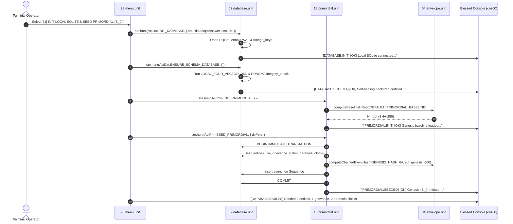
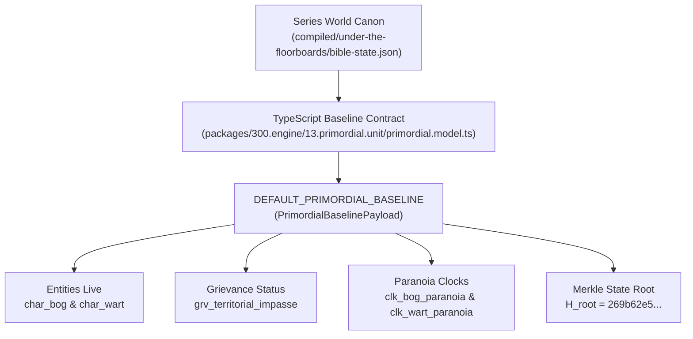

# [1] INIT LOCAL SQLITE & SEED PRIMORDIAL (S_0)

> Documentation for the highlighted terminal menu item in `ENGINE MENU` (`packages/300.engine`).

---

## 1. Overview & Operational Role

In the Blessed Terminal Cockpit under the **`ENGINE MENU`**, the menu item:

```text
[1] INIT LOCAL SQLITE & SEED PRIMORDIAL (S_0)
```
*(displayed as `[1] INIT LOCAL SQLITE & SEED` in constrained menu viewports)*

serves as the **Genesis State Bootstrap ($S_0$)** and **Local SQLite Provisioner** for the simulation engine (`packages/300.engine`).

Selecting this entry guarantees an idempotent, atomic sequence that:
1. Connects and hardens the local SQLite database file at `data/sqlite/sower.local.db`.
2. Certified-executes the dialect-pure 4-Vector Data Definition Language (DDL), bootstrapping **7 tables**, **2 immutability triggers**, and associated indices.
3. Computes the deterministic RFC 8785 canonical hash of the primordial baseline ($H_{\text{root}}$).
4. Commits the Genesis state transaction: seeding entities, initial grievances, and paranoia clocks.
5. Mints **Sequence #1** into `event_log` (`evt_genesis_000`) at Tick 0, cryptographically sealed against `GENESIS_HASH_64` ($0^{64}$) and $H_{\text{root}}$.
6. Streams non-blocking telemetry to the Blessed TUI console (`cns00`).

---

## 2. Dispatch Call Chain & Architecture

The invocation is handled by [packages/300.engine/98.menu.unit/buz/00.menu.buzz.ts](file:///d:/trellis/000.series-sower-engine/packages/300.engine/98.menu.unit/buz/00.menu.buzz.ts):



### Action Manifest

| Action Identifier | Source Unit | Purpose |
| :--- | :--- | :--- |
| `ActDat.INIT_DATABASE` | [02.database.unit](file:///d:/trellis/000.series-sower-engine/packages/300.engine/02.database.unit/buz/database.buzz.ts#L249-L294) | Opens driver port (`better-sqlite3` or `node:sqlite`), enforces WAL mode and foreign key integrity. |
| `ActDat.ENSURE_SCHEMA_DATABASE` | [02.database.unit](file:///d:/trellis/000.series-sower-engine/packages/300.engine/02.database.unit/buz/database.buzz.ts#L311-L365) | Executes 4-Vector DDL and verifies database schema health via `PRAGMA integrity_check`. |
| `ActPrm.INIT_PRIMORDIAL` | [13.primordial.unit](file:///d:/trellis/000.series-sower-engine/packages/300.engine/13.primordial.unit/buz/primordial.buzz.ts#L49-L73) | Loads primordial baseline contracts and derives Merkle state root $H_{\text{root}}$. |
| `ActPrm.SEED_PRIMORDIAL` | [13.primordial.unit](file:///d:/trellis/000.series-sower-engine/packages/300.engine/13.primordial.unit/buz/primordial.buzz.ts#L111-L342) | Atomically executes the Genesis database transaction. |

---

## 3. Database Engine & Schema Specification

The database adapter implements [ILocalDatabasePort](file:///d:/trellis/000.series-sower-engine/packages/300.engine/02.database.unit/fce/database.interface.ts) wrapping `better-sqlite3` with fallback to Node 22+ native `node:sqlite`.

### SQLite Pragmas Applied
- `PRAGMA foreign_keys = ON;` — Guarantees relational referential integrity across tables.
- `PRAGMA journal_mode = WAL;` — Write-Ahead Logging for high-concurrency readers and crash durability.
- `PRAGMA synchronous = NORMAL;` — Optimal balance between disk I/O throughput and persistence safety.

### 7 Relational Tables (`LOCAL_FOUR_VECTOR_DDL`)

1. **`event_log`**: Authoritative, cryptographic append-only event ledger.
   - Columns: `sequence_id` (PK AUTOINCREMENT), `event_id` (UNIQUE), `stream_id`, `tick`, `event_type`, `schema_version`, `actor_id`, `target_id`, `seed`, `payload_json`, `topology_hash`, `overlay_hash`, `query_hash`, `receipt_hash`, `prev_event_hash` (64-hex), `state_hash` (64-hex), `timestamp_ms`.
   - Indices: `idx_event_stream_seq(stream_id, sequence_id)`, `idx_event_tick(tick)`.
2. **`entities_live`**: Materialized working state for somatic, spatial, and logistical vectors.
   - Columns: `entity_id` (PK), `location_id`, `coord_q`, `coord_r`, `arms_available` (0-2), `legs_available` (0-2), `locomotion_tier` (`UNRESTRICTED`, `LIMPING`, `IMMOBILIZED`), `concussion_level` (0-3), `fatigue_bps` (0-10000), `pain_bps` (0-10000), `refusal_strain_bps` (0-10000), `open_wounds_json`, `banned_kinetic_verbs_json`, `held_items_json`, `worn_gear_json`, `slung_items_json`, `cached_items_json`, `updated_at_ms`.
   - Indices: `idx_entities_location(location_id)`, `idx_entities_coords(coord_q, coord_r)`.
3. **`strings_ledger`**: Relational leverage and inter-actor social debt obligations.
   - Columns: `relation_id` (PK), `holder_id`, `debtor_id`, `weight_bps`, `strings_count`, `updated_at_ms`.
   - Constraints: Anti-reflexive check (`holder_id != debtor_id`), `UNIQUE(holder_id, debtor_id)`.
4. **`grievance_status`**: Escalation depth and cooldown cycles between conflicting agents.
   - Columns: `grievance_id` (PK), `instigator_id`, `victim_id`, `escalation_depth`, `cooldown_cycles`, `intensity_bps`, `status` (`DORMANT`, `ACTIVE`, `SIMMERING`, `RESOLVED`), `updated_at_ms`.
   - Constraints: Anti-reflexive check (`instigator_id != victim_id`).
5. **`paranoia_clocks`**: Unified pressure meters with threshold monitoring and decay.
   - Columns: `clock_id` (PK), `entity_id`, `clock_name`, `value_bps`, `threshold_bps`, `decay_rate_bps`, `is_triggered`, `updated_at_ms`.
   - Constraints: `UNIQUE(entity_id, clock_name)`.
6. **`actor_beliefs`**: Epistemic vector tracking subjective probability estimates.
   - Columns: `belief_id` (PK), `observer_id`, `fact_id`, `subjective_probability_bps`, `source_type` (`INFERENCE`, `TESTIMONY`, `DIRECT_OBSERVATION`), `is_false_belief`, `learned_at_ms`, `updated_at_ms`.
   - Constraints: `UNIQUE(observer_id, fact_id)`.
7. **`unratified_details`**: Incidental detail quarantine and narrative harvest queue.
   - Columns: `detail_id` (PK), `scene_id`, `entity_id`, `salience_bps`, `claim_proposal`, `status` (`STAGED`, `DISCARDED`, `RATIFIED`), `created_at_ms`, `reviewed_at_ms`.

### 2 Immutability Triggers
- `trg_event_log_no_update`: Blocks any `UPDATE` statements on `event_log` via `RAISE(ABORT, 'IMMUTABILITY_VIOLATION: event_log is strictly append-only')`.
- `trg_event_log_no_delete`: Blocks any `DELETE` statements on `event_log` via `RAISE(ABORT, 'IMMUTABILITY_VIOLATION: event_log is strictly append-only')`.

---

## 4. Primordial Genesis Baseline ($S_0$)

Defined in [packages/300.engine/13.primordial.unit/primordial.model.ts](file:///d:/trellis/000.series-sower-engine/packages/300.engine/13.primordial.unit/primordial.model.ts), the baseline specification establishes initial conditions:

```json
{
  "seriesSlug": "under-the-floorboards",
  "version": 1,
  "originLocationId": "loc_the_warm_pipe",
  "founderTokenId": "item_founder_token"
}
```

### Seeded Entity Vectors

| Field | Entity 1: `char_bog` | Entity 2: `char_wart` |
| :--- | :--- | :--- |
| **Location** | `loc_the_warm_pipe` (0, 0) | `loc_the_warm_pipe` (1, 0) |
| **Limbs** | 2 Arms, 2 Legs | 1 Arm, 2 Legs |
| **Locomotion Tier** | `UNRESTRICTED` | `LIMPING` |
| **Concussion / Strain** | 0 concussion, 0 bps strain | 0 concussion, 500 bps refusal strain |
| **Fatigue / Pain** | 0 bps fatigue, 0 bps pain | 1500 bps fatigue, 2500 bps pain |
| **Open Wounds** | `[]` | `["laceration_left_shoulder"]` |
| **Banned Kinetic Verbs** | `[]` | `["BIMANUAL_LIFT", "SPRINT"]` |
| **Held Items** | `["item_founder_token"]` | `[]` |
| **Worn Gear** | `{ "belt": "item_scrap_pouch" }` | `{}` |

### Seeded Grievances & Clocks

- **Grievance `grv_territorial_impasse`**:
  - Instigator: `char_bog` $\to$ Victim: `char_wart`
  - Status: `ACTIVE`
  - Escalation Depth: 1
  - Intensity: 2500 bps
- **Paranoia Clock `clk_bog_paranoia`**:
  - Entity: `char_bog` | Baseline: 2500 bps | Threshold: 7500 bps | Decay: 50 bps/cycle
- **Paranoia Clock `clk_wart_paranoia`**:
  - Entity: `char_wart` | Baseline: 4000 bps | Threshold: 7500 bps | Decay: 50 bps/cycle

---

## 5. Cryptographic Sealing & Golden Hashes

Genesis state hashing is governed by RFC 8785 canonical JSON sorting and SHA-256.

### Genesis Root Hash ($H_{\text{root}}$)
Computed via `computeBaselineHRoot(DEFAULT_PRIMORDIAL_BASELINE)`:
```text
H_root = 269b62e561208e759c32b73b697159774373cabe954940cafe5df9c931a8eabd
```

### Event Log Sequence #1 (`evt_genesis_000`)
- **Event ID**: `evt_genesis_000`
- **Stream**: `main`
- **Sequence**: `1`
- **Tick**: `0`
- **Type**: `SIMULATION_TICK_COMMITTED`
- **Previous Event Hash**: `0000000000000000000000000000000000000000000000000000000000000000` (`GENESIS_HASH_64`)
- **State Hash**: $H_{\text{root}}$
- **Sealed Event Hash**:
```text
EventHash = 1686cb4b477f1074b4f6ff8d281adf6daefc83f32f09968cb553224ec1422c70
```

---

## 6. Terminal Console Telemetry (`cns00`)

Upon selecting the menu option, the operator sees the following confirmation trace streamed to the upper log console:

```text
>> [DATABASE:INIT] [OK] Local SQLite connected: data/sqlite/sower.local.db
>> [DATABASE:SCHEMA] [OK] Self-healing bootstrap certified. 7 tables, 2 triggers online. Integrity: ok
>> [PRIMORDIAL:INIT] [OK] Genesis baseline loaded. H_root: 269b62e5...
>> [PRIMORDIAL:SEEDED] [OK] Genesis (S_0) minted! H_root: 269b62e5... | EventHash: 1686cb4b...
>> [DATABASE:TABLES] Seeded 2 entities, 1 grievance, 2 paranoia clocks.
```

> **Note on Telemetry Isolation:**
> Telemetry emits strictly across `global.LIBRARY.hunt('[Console action] Update Console', ...)`. It never dispatches to the internal engine state bus (`ste.hunt`), preventing deadlocks in the curses event loop.

---

## 7. Verification & Testing

To execute automated test coverage verifying this exact flow:

```bash
# Run unit test battery for 13.primordial.unit & 02.database.unit
npm run test:engine
```

Specific test suites:
- [packages/300.engine/13.primordial.unit/primordial.test.ts](file:///d:/trellis/000.series-sower-engine/packages/300.engine/13.primordial.unit/primordial.test.ts): Verifies deterministic $H_{\text{root}}$, Genesis Sequence #1 insertion, idempotency, and golden hashes.
- [packages/300.engine/02.database.unit/database.test.ts](file:///d:/trellis/000.series-sower-engine/packages/300.engine/02.database.unit/database.test.ts): Verifies 7 tables, trigger abort behavior on updates/deletes in `event_log`, and PRAGMA integrity.

---

## 8. Provenance & Origin of Primordial Elements

The initial state vectors seeded during Genesis ($S_0$) are not arbitrarily generated at runtime; they are rooted in the **Byte-0 Baseline Contract** codified within the simulation engine and derived from canonical narrative axioms.



### 8.1 Source Code Origin & Schema Contract

All primordial data originates in [packages/300.engine/13.primordial.unit/primordial.model.ts](file:///d:/trellis/000.series-sower-engine/packages/300.engine/13.primordial.unit/primordial.model.ts#L4-L78) via the exported constant `DEFAULT_PRIMORDIAL_BASELINE`.

This structure is strictly typed by the [PrimordialBaselinePayload](file:///d:/trellis/000.series-sower-engine/packages/300.engine/13.primordial.unit/fce/primordial.interface.ts#L4-L45) interface, which prescribes:
- `seriesSlug`: Unique namespace identifying the active fictional world (`"under-the-floorboards"`).
- `version`: Baseline schema revision (`1`).
- `originLocationId`: Primary anchor coordinate (`"loc_the_warm_pipe"`).
- `founderTokenId`: Sovereign relic (`"item_founder_token"`).
- `entities`: Array of [PrimordialEntityPayload](file:///d:/trellis/000.series-sower-engine/packages/300.engine/13.primordial.unit/fce/primordial.interface.ts#L4-L24).
- `grievances`: Array of [PrimordialGrievancePayload](file:///d:/trellis/000.series-sower-engine/packages/300.engine/13.primordial.unit/fce/primordial.interface.ts#L26-L35).
- `clocks`: Array of [PrimordialClockPayload](file:///d:/trellis/000.series-sower-engine/packages/300.engine/13.primordial.unit/fce/primordial.interface.ts#L37-L45).

### 8.2 Narrative Lore Origin (`under-the-floorboards`)

The data models a micro-scale subterranean ecosystem situated beneath residential floorboards:

- **World Setting**: The domestic sub-floor environment where small denizens survive around thermal sources and discarded human artifacts.
- **`loc_the_warm_pipe`**: The central thermal origin at hex `(0, 0)`, representing the most contested and vital heat conduit in the floorboards.
- **`item_founder_token`**: The authoritative claim marker that justifies territorial primacy.

### 8.3 Entity Provenance & Somatic Asymmetry

The two starting entities establish an asymmetric conflict dynamic from Byte-0:

#### 1. `char_bog` (Dominant Occupant)
- **Origin**: Bog is the incumbent claimant holding the Warm Pipe.
- **Position**: Stationed directly on hex `(0, 0)` at `loc_the_warm_pipe`.
- **Physical Condition**: Completely uninjured — 2 arms available, 2 legs available, `UNRESTRICTED` locomotion tier, 0 concussion, 0 fatigue, 0 pain, and 0 refusal strain.
- **Inventory & Gear**: Holds the sole `item_founder_token` in hand, with `item_scrap_pouch` equipped on his belt.
- **Kinetic Freedom**: Unrestricted (`bannedKineticVerbs: []`).

#### 2. `char_wart` (Displaced & Injured Challenger)
- **Origin**: Wart is the injured, displaced rival occupying the adjacent perimeter.
- **Position**: One hex away at `(1, 0)` within `loc_the_warm_pipe`.
- **Somatic Trauma**: Manifests severe physical impairment:
  - **Limbs**: Only 1 arm functional (`arms_available: 1`), 2 legs available.
  - **Open Wounds**: Active trauma in `open_wounds_json` (`"laceration_left_shoulder"`).
  - **Locomotion Tier**: Degraded to `LIMPING`.
  - **Strain & Distress**: 1,500 bps (15%) fatigue, 2,500 bps (25%) pain, and 500 bps (5%) refusal strain.
- **Banned Kinetic Verbs**: Structurally blocked by physical capability checks from executing `BIMANUAL_LIFT` (lacks two functional arms) and `SPRINT` (inhibited by limping locomotion and shoulder laceration).
- **Inventory**: Stripped of equipment (`heldItems: []`, `wornGear: {}`).

### 8.4 Initial Grievance Provenance (`grv_territorial_impasse`)

The grievance record models an unresolved, high-tension social dispute:

- **Instigator vs. Victim**: `char_bog` (instigator) vs. `char_wart` (victim).
- **Relational Impasse**: Emerges from Bog's physical defense of the Warm Pipe and possession of the founder token versus Wart's proximity and refusal to vacate the adjoining hex.
- **Parameters**:
  - `status: 'ACTIVE'`: Enters the simulation in an active conflict state rather than dormant.
  - `escalationDepth: 1`: First tier of interpersonal hostility.
  - `intensityBps: 2500` (25% intensity): Puts immediate pressure on decision trees during simulation ticks.
  - `cooldownCycles: 0`: Ready for action resolution immediately without awaiting cooldown expiry.
- **Integrity Rule**: Satisfies the SQLite database check constraint `chk_anti_reflexive_grievance` (`instigator_id != victim_id`).

### 8.5 Paranoia Clocks Provenance (`clk_bog_paranoia` & `clk_wart_paranoia`)

Paranoia clocks represent integer-based tension meters (0 to 10,000 basis points) that govern flight-or-fight triggers without floating-point inaccuracies or real-world wall-clock dependence:

| Metric | Bog's Clock (`clk_bog_paranoia`) | Wart's Clock (`clk_wart_paranoia`) | Rationale |
| :--- | :--- | :--- | :--- |
| **Associated Entity** | `char_bog` | `char_wart` | Each clock is tied to a specific entity via `UNIQUE(entity_id, clock_name)`. |
| **Clock Name** | `paranoia_baseline` | `paranoia_baseline` | Standard baseline alertness meter. |
| **Initial Value** | **2,500 bps** (25.0%) | **4,000 bps** (40.0%) | Wart starts at higher paranoia due to his vulnerable somatic state (1 arm, wound, limping). |
| **Trigger Threshold** | **7,500 bps** (75.0%) | **7,500 bps** (75.0%) | Critical paranoia threshold where flight/panic behaviors activate (`is_triggered = 1`). |
| **Decay Rate** | **50 bps/cycle** | **50 bps/cycle** | Natural relaxation rate applied deterministically by `17.tick.unit` per simulation epoch. |

### 8.6 Upstream Canon Synchronization

In the broader monorepo ecosystem, these baseline definitions correspond to compiled world bibles (such as `000.goblin-lore` / `compiled/<series>/bible-state.json`).

Embedding them directly into `13.primordial.unit` ensures:
1. **Zero External Dependencies**: The engine boots without external API calls, network queries, or file scrapers.
2. **Zero-Drift Genesis**: The deterministic RFC 8785 canonical hash ($H_{\text{root}} = \texttt{269b62e5...}$) remains bit-for-bit identical regardless of operating system, node environment, or platform architecture.
3. **Instant Replayability**: Any simulation started from this Genesis state ($S_0$) can be audited or replayed across any historical tick $T_n$ with mathematical certainty.

