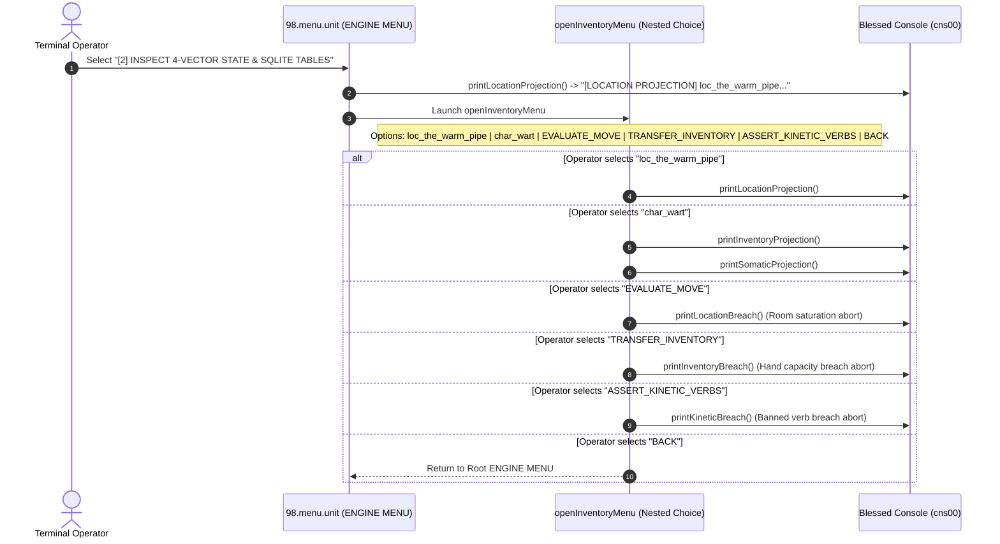
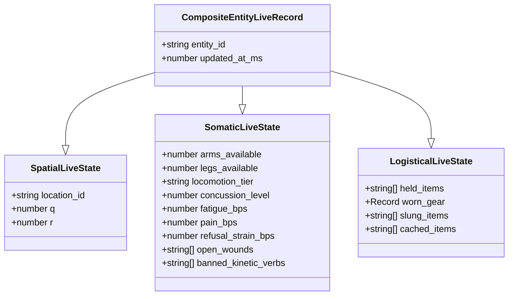

# [2] INSPECT 4-VECTOR STATE & SQLITE TABLES

> Documentation for the highlighted terminal menu item in `ENGINE MENU` (`packages/300.engine`).

---

## 1. Overview & Operational Role

In the Blessed Terminal Cockpit under the **`ENGINE MENU`**, the menu item:

```text
[2] INSPECT 4-VECTOR STATE & SQLITE TABLES
```
*(displayed as `[2] INSPECT 4-VECTOR STATE & SQLITE` in constrained menu viewports)*

provides real-time diagnostics, panopticon projections, and boundary tripwire auditing for the **Four-Vector Materialized Working State** (`Spatial`, `Somatic`, `Logistical`, and `Relational/Epistemic`).

While menu option `[1]` seeds the database from cold storage ($S_0$), menu option `[2]` allows the operator to:
1. **Inspect Materialized Working States:** Query live entity rows, axial hex coordinates, room occupancy levels, and inventory containment slots.
2. **Audit Biological & Logistical Invariants:** Verify that somatic trauma (e.g. an amputated arm) correctly restricts kinetic actions and constrains hand slot capacities.
3. **Trigger Directorial Abort Probes ($T_0 = \$0.00$):** Interactively test and assert that out-of-bounds actions (room saturation, hand capacity violations, or banned kinetic verbs) are halted instantly with zero token cost.

---

## 2. Dispatch Flow & Sub-Menu Architecture

Selecting option `[2]` in [packages/300.engine/98.menu.unit/buz/00.menu.buzz.ts](file:///d:/trellis/000.series-sower-engine/packages/300.engine/98.menu.unit/buz/00.menu.buzz.ts#L527-L530) executes `printLocationProjection()` and immediately shifts the Blessed viewport into the nested **Spatial / Entity / Inventory Sub-Menu** (`openInventoryMenu`):



---

## 3. The Four-Vector State Model

The engine models reality through four tightly coupled, mathematical vectors codified in [packages/300.engine/16.state.unit/fce/state.interface.ts](file:///d:/trellis/000.series-sower-engine/packages/300.engine/16.state.unit/fce/state.interface.ts):



### Vector 1: Spatial Vector (`SpatialLiveState`)
- **Discrete Topology:** Tracks discrete hex axial coordinates `(coord_q, coord_r)` and location container IDs (`location_id`).
- **Environmental Attributes:** Acoustic damping measured in centibels (`cdB`), ambient illumination measured in basis points / lux (`0.15 lux = 2,000 bps`), and dynamic portal states (e.g. `hatch_valve_04 [LOCKED]`).
- **Capacity Constraint:** Every location enforces a strict volumetric occupant ceiling (`Capacity: 2/2 SATURATED`).

### Vector 2: Somatic Vector (`SomaticLiveState`)
- **Anatomical Availability:** Explicit floating limb counts: `arms_available` ($0.0 \dots 2.0$) and `legs_available` ($0.0 \dots 2.0$).
- **Locomotion Tier:** Classified as `UNRESTRICTED`, `LIMPING`, or `IMMOBILIZED`.
- **Physiological Pressures:** Measured in basis points ($0 \dots 10,000$ bps):
  - `fatigue_bps`: Physical exhaustion.
  - `pain_bps`: Sensory distress and shock.
  - `refusal_strain_bps`: Psychological resistance ($>8,000$ bps warns of imminent violent retaliation).
- **$O(1)$ Set-Intersection Gate:** An active list of `banned_kinetic_verbs` (e.g. `BIMANUAL_LIFT`, `SPRINT`, `VAULT`) that cannot be executed by the actor.

### Vector 3: Logistical Vector (`LogisticalLiveState`)
- **4-Tier Item Containment Hierarchy:**
  1. `held_items`: Items held in hands, strictly bounded by `arms_available` ($\text{Held Items} \le \text{Arms Available}$).
  2. `worn_gear`: Body-slotted apparel and armor (e.g. `{ torso: "item_tallow_apron" }`).
  3. `slung_items`: Shoulder/back-slung bags and equipment.
  4. `cached_items`: Stashed or grounded items within immediate reach.

### Vector 4: Relational & Epistemic Vector
- **Leverage Strings (`strings_ledger`):** Directed social debt between actors with anti-reflexive checks (`holder_id != debtor_id`).
- **Grievance Status (`grievance_status`):** Active interpersonal friction with escalation depth and integer cooldown cycles.
- **Paranoia Clocks (`paranoia_clocks`):** Threat alertness meters decaying deterministically by 50 bps per tick.
- **Actor Beliefs (`actor_beliefs`):** Subjective probability estimates in basis points ($0 \dots 10,000$ bps).

---

## 4. Interactive Sub-Menu Options & Projections

When entering the nested menu, the operator can select from six items:

```text
[loc_the_warm_pipe]
[char_wart]
[EVALUATE_MOVE]
[TRANSFER_INVENTORY]
[ASSERT_KINETIC_VERBS]
[BACK]
```

### 4.1 Option `[loc_the_warm_pipe]` — Spatial Projection
Inspects the environmental conditions of the primary series hex:

```text
>> [LOCATION PROJECTION] loc_the_warm_pipe (Capacity: 2/2 SATURATED)
>> ACOUSTIC DAMPING : 1,500 cdB | AMBIENT ILLUMINATION: 2,000 bps (0.15 lux)
>> DYNAMIC PORTALS  : hatch_valve_04 [LOCKED]
>> ACTIVE OCCUPANTS : char_bog (10, 2, -12), char_wart (11, 2, -13)
>> ENTITY LIVE ROW  : char_wart [ARMS: 1 | LIMPING | PAIN: 6,000 bps]
```

### 4.2 Option `[char_wart]` — Somatic & Logistical Panopticon
Queries and displays both the logistical slots and somatic deficit of the wounded challenger:

```text
>> [INVENTORY PROJECTION] char_wart (Arms Available: 1.0)
>> HELD SLOTS    : [item_iron_knife] (1/1 Capacity Saturated)
>> WORN SLOTS    : { torso: "item_tallow_apron" }
>> SLUNG SLOTS   : [item_scavenged_sack]
>> CACHED SLOTS  : [item_copper_flange, item_iron_pipe]
>> STATUS        : [OK] Hand Capacity Invariant Satisfied

>> [SOMATIC PANOPTICON] char_wart (Gait: LIMPING)
>> OPEN WOUNDS      : [SEVERED_LEFT_ARM]
>> ARMS AVAILABLE   : 1.0 / 2.0
>> BANNED VERBS (9) : BIMANUAL_LIFT, CLIMB, EMBRACE, GRAPPLE_TWO_HANDED, HEAVE, PRY_BILATERAL, SPRINT, VAULT, WRENCH
>> AUDIT STATUS     : [OK] O(1) Set-Intersection Gate Online
>> AVAILABLE ARMS: 1.0 / 2.0 (Trauma: SEVERED_LEFT_ARM)
>> LOCOMOTION    : LIMPING (Pain: 6,000 bps)
>> REFUSAL STRAIN: 8,500 / 10,000 bps [STRAINED - RETALIATION IMMINENT]
```

### 4.3 Option `[EVALUATE_MOVE]` — Room Capacity Breach Probe
Simulates an unauthorized movement into an already saturated hex (`Capacity: 2/2`), triggering immediate refusal:

```text
>> [ROOM_CAPACITY_EXCEEDED] Location 'loc_the_warm_pipe' capacity saturated (3/2)
>> DIRECTORIAL ACTION: Transaction aborted at T0 = $0.00
```

### 4.4 Option `[TRANSFER_INVENTORY]` — Hand Capacity Invariant Probe
Simulates an attempt to force a second held item into an entity with only 1 functional arm:

```text
>> [HAND_CAPACITY_BREACH] Entity char_wart has 1 arm(s) available, cannot hold 2 items!
>> DIRECTORIAL ACTION: Transaction aborted at T0 = $0.00
```

### 4.5 Option `[ASSERT_KINETIC_VERBS]` — Somatic Capability Breach Probe
Simulates an actor attempting an anatomical verb that is prohibited by their active open wounds:

```text
>> [SOMATIC_CAPABILITY_BREACH] Actor char_wart attempted banned verb(s): [BIMANUAL_LIFT]
>> ACTIVE ANATOMICAL DEFICIT: SEVERED_LEFT_ARM (Arms Available: 1.0 / 2.0)
>> ARMS AVAILABLE: 1.0 / 2.0 | ACTIVE TRAUMA: SEVERED_LEFT_ARM
>> DIRECTORIAL ACTION: Transaction aborted at T0 = $0.00
```

### 4.6 Option `[BACK]`
Exits the nested choice loop and returns the cockpit to the root `ENGINE MENU`.

---

## 5. Directorial Invariants & Zero-Cost Abort ($T_0 = \$0.00$)

A foundational law of `series-sower-engine` is **Deterministic Pre-Execution Validation**:

$$\text{LLM / AI Token Spend} = \$0.00 \quad \text{if} \quad \text{Invariant}(\text{Action}) = \text{FALSE}$$

Before prompting an LLM or committing an event to `event_log`:
1. The **Somatic Gate** evaluates kinetic verbs against `banned_kinetic_verbs` via $O(1)$ set lookup.
2. The **Logistical Gate** verifies that $\text{count}(\text{held\_items}) \le \text{arms\_available}$.
3. The **Spatial Gate** verifies that $\text{count}(\text{occupants}) \le \text{location\_capacity}$.

If any gate fails, the transaction is rejected instantly in local SQLite / TypeScript memory without calling remote workers or executing AI generation.

---

## 6. Verification & Automated Test Coverage

This menu item and its underlying Four-Vector mechanisms are verified across multiple test suites in `packages/300.engine`:

```bash
# Test 16.state.unit (Four-vector composite state hydration & freezing)
npx vitest run packages/300.engine/16.state.unit/state.test.ts

# Test 02.database.unit (SQLite Four-Vector table definitions & check constraints)
npx vitest run packages/300.engine/02.database.unit/database.test.ts

# Test 18.trauma.unit (Somatic wounds & banned kinetic verbs)
npx vitest run packages/300.engine/18.trauma.unit/trauma.test.ts
```
