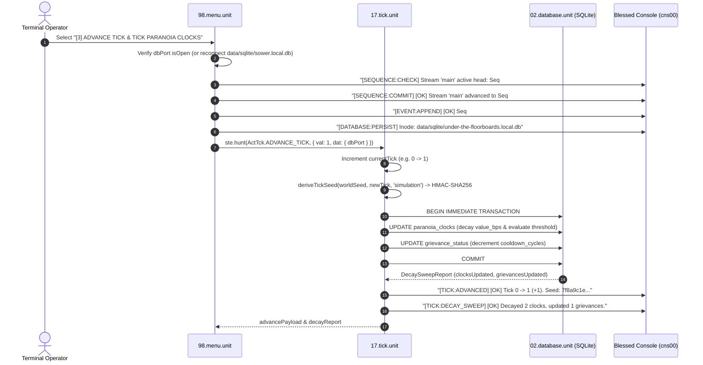

# [3] ADVANCE TICK & TICK PARANOIA CLOCKS

> Documentation for the highlighted terminal menu item in `ENGINE MENU` (`packages/300.engine`).

---

## 1. Overview & Strategic Role

In the Blessed Terminal Cockpit under the **`ENGINE MENU`**, the menu item:

```text
[3] ADVANCE TICK & TICK PARANOIA CLOCKS
```
*(displayed as `[3] ADVANCE TICK & TICK PARANOIA` in constrained menu viewports)*

serves as the **Discrete Time Governor**, **Deterministic Entropy Provider**, and **Passive Decay Evaluator** for the simulation engine (`packages/300.engine`).

In an event-sourced simulation, physical system clocks (`Date.now()`, wall-clock time) are untrusted variables: they drift between devices, leap across time zones, and introduce non-deterministic entropy that destroys historical replayability. Menu option `[3]` implements **Absolute Wall-Clock Independence** and **Bit-Exact Reproducibility** by:
1. Incrementing the logical simulation epoch monotonically ($\text{Tick} \to \text{Tick} + 1$).
2. Deriving a cryptographic, platform-agnostic PRNG entropy seed via HMAC-SHA256 (`deriveTickSeed`).
3. Executing an atomic SQLite transaction that applies passive basis-point decay calculations to `paranoia_clocks` and decrements active `grievance_status` cooldown cycles.
4. Emitting non-blocking telemetry and event sequence validation to the terminal console (`cns00`).

---

## 2. Dispatch Flow & Architecture

Selecting option `[3]` in [packages/300.engine/98.menu.unit/buz/00.menu.buzz.ts](file:///d:/trellis/000.series-sower-engine/packages/300.engine/98.menu.unit/buz/00.menu.buzz.ts#L494-L525) executes the following sequence:



---

## 3. Deterministic PRNG Entropy Derivation

To guarantee that dice rolls, AI decisions, and kinetic outcomes are completely reproducible:
- **Zero Unseeded Math:** Native `Math.random()` calls are strictly forbidden across simulation units.
- **Cryptographic Key Derivation:** Every tick derives an isolated, 64-character lowercase hex seed using Node's native `node:crypto` `createHmac`:

$$\text{Seed}_{T} = \text{HMAC-SHA256}\Big(\text{worldSeed}, \;\; \texttt{"simulation"} : T\Big)$$

Defined in [packages/300.engine/17.tick.unit/buz/tick.buzz.ts](file:///d:/trellis/000.series-sower-engine/packages/300.engine/17.tick.unit/buz/tick.buzz.ts#L37-L45):

```typescript
export function deriveTickSeed(
    worldSeed: string,
    tickNumber: number,
    subsystemId = 'simulation',
): string {
    return createHmac('sha256', worldSeed)
        .update(`${subsystemId}:${tickNumber}`, 'utf8')
        .digest('hex')
}
```

This guarantees that whether a simulation is replayed locally today or five years from now on an edge isolate, Tick 5 will always yield the exact same seed and identical downstream results.

---

## 4. Atomic Database Decay Sweep (`executeDecaySweep`)

Simulation time progression passively cools interpersonal grievances and relaxes actor paranoia. Rather than hydrating rows into memory, performing math in JavaScript, and writing them back, `17.tick.unit` executes dialect-pure SQL integer math directly inside SQLite:

### 4.1 Paranoia Clock Decay Sweep
Decrements each clock by its `decay_rate_bps` multiplied by the elapsed ticks, while ensuring it never drops below 0:

$$\text{value\_bps}_{T+1} = \max\Big(0, \; \text{value\_bps}_{T} - (\text{decay\_rate\_bps} \times \Delta T)\Big)$$

Simultaneously evaluates the trigger flag (`is_triggered`):

```sql
UPDATE paranoia_clocks
SET value_bps = MAX(0, value_bps - (decay_rate_bps * ?)),
    is_triggered = CASE 
      WHEN MAX(0, value_bps - (decay_rate_bps * ?)) >= threshold_bps THEN 1 
      ELSE 0 
    END,
    updated_at_ms = ?
WHERE decay_rate_bps > 0 AND value_bps > 0;
```

**Concrete Genesis Example:**
- `clk_bog_paranoia`: Starts at **2,500 bps**. With decay rate **50 bps/tick**, after 1 tick it decays to **2,450 bps**.
- `clk_wart_paranoia`: Starts at **4,000 bps**. With decay rate **50 bps/tick**, after 1 tick it decays to **3,950 bps**.
- Both remain below the **7,500 bps** threshold, so `is_triggered` remains `0`.

### 4.2 Grievance Cooldown Decrement Sweep
Decrements the remaining cooldown cycles of active grievances until they reach 0 (ready for subsequent action or resolution):

$$\text{cooldown\_cycles}_{T+1} = \max\Big(0, \; \text{cooldown\_cycles}_{T} - \Delta T\Big)$$

```sql
UPDATE grievance_status
SET cooldown_cycles = MAX(0, cooldown_cycles - ?),
    updated_at_ms = ?
WHERE cooldown_cycles > 0;
```

---

## 5. Terminal Console Telemetry (`cns00`)

When menu option `[3]` is triggered in the cockpit, the upper console receives the stream verification and tick advance report:

```text
>> [SEQUENCE:CHECK] Stream 'main' active head: Seq #0
>> [SEQUENCE:COMMIT] [OK] Stream 'main' advanced to Seq #1 (evt_tick_01)
>> [EVENT:APPEND] [OK] Seq #1 | SOMATIC_TRAUMA_APPLIED | evt_som_01 | Hash: 7f8a9c...
>> [DATABASE:PERSIST] Inode: data/sqlite/under-the-floorboards.local.db
>> [TICK:ADVANCED] [OK] Tick 0 -> 1 (+1). Seed: a8f41c9b...
>> [TICK:DECAY_SWEEP] [OK] Decayed 2 clocks, updated 1 grievances.
```

> **Non-Blocking Telemetry Law:**
> Telemetry emits strictly via `global.LIBRARY.hunt('[Console action] Update Console', ...)`. Dispatches never target the engine state bus (`ste.hunt`), avoiding deadlocks in the blessed rendering loop.

---

## 6. Verification & Automated Test Coverage

This unit and its deterministic math are covered in [packages/300.engine/17.tick.unit/tick.test.ts](file:///d:/trellis/000.series-sower-engine/packages/300.engine/17.tick.unit/tick.test.ts):

```bash
# Run unit tests for 17.tick.unit
npx vitest run packages/300.engine/17.tick.unit/tick.test.ts
```

### Verified Assertions:
1. **HMAC-SHA256 Determinism:** Seed generation is idempotent across identical parameters and diverges across distinct ticks.
2. **Monotonic Tick Progression:** Logical ticks advance strictly by positive integer steps and update internal model state.
3. **SQLite Integer Math Parity:** Verified that `paranoia_clocks` decay exactly by `decay_rate_bps * deltaTicks` and `grievance_status` cooldowns decrement without negative integer underflow.
4. **Non-Blocking Console Degradation:** Confirmed that a stalled engine bus does not freeze the tick progression loop.
