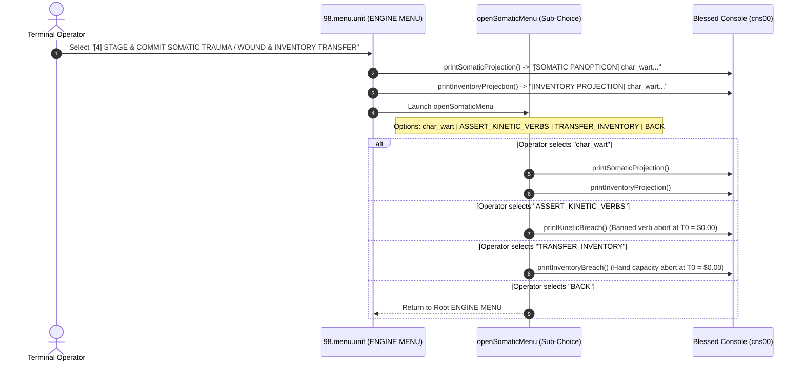

# [4] STAGE & COMMIT SOMATIC TRAUMA / WOUND & INVENTORY TRANSFER

> Documentation for the highlighted terminal menu item in `ENGINE MENU` (`packages/300.engine`).

---

## 1. Overview & Strategic Role

In the Blessed Terminal Cockpit under the **`ENGINE MENU`**, the menu item:

```text
[4] STAGE & COMMIT SOMATIC TRAUMA / WOUND & INVENTORY TRANSFER
```
*(displayed as `[4] STAGE & COMMIT SOMATIC TRAUMA /` in constrained menu viewports)*

manages the **Somatic-Kinetic-Logistical Coupling Pipeline** across three core units:
- [18.trauma.unit](file:///d:/trellis/000.series-sower-engine/packages/300.engine/18.trauma.unit) (physiological basis-point math, limb ceilings, locomotion tiers, refusal strain).
- [19.wounds.unit](file:///d:/trellis/000.series-sower-engine/packages/300.engine/19.wounds.unit) (anatomical wound conditions and $O(1)$ kinetic verb masks).
- [07.inventory.unit](file:///d:/trellis/000.series-sower-engine/packages/300.engine/07.inventory.unit) (hand capacity bounds and slot mass conservation).

In naive game engines, character health is a scalar float (`HP = 42.5/100`) and inventory slots are abstract grids disconnected from physical anatomy. In `series-sower-engine`:
1. **Anatomy Governs Capability:** Physical trauma directly constrains action verbs. An actor with an amputated arm cannot execute `BIMANUAL_LIFT` or `CLIMB`.
2. **Anatomy Governs Inventory:** The number of held items cannot exceed available functional arms ($\text{Held Items} \le \text{Arms Available}$).
3. **Zero-Cost Rejection ($T_0 = \$0.00$):** Invariant breaches (holding too many items or attempting banned verbs) are rejected deterministically in local memory before prompting LLMs or recording events.
4. **Conservation of Inventory:** When trauma amputates an arm, held items are not deleted; excess items automatically spill into `cached_items` (grounded).

---

## 2. Dispatch Flow & Sub-Menu Architecture

Selecting option `[4]` in [packages/300.engine/98.menu.unit/buz/00.menu.buzz.ts](file:///d:/trellis/000.series-sower-engine/packages/300.engine/98.menu.unit/buz/00.menu.buzz.ts#L532-L539) immediately prints both the **Somatic Panopticon** and **Inventory Projection** to `cns00`, and then opens the interactive **Somatic Sub-Menu** (`openSomaticMenu`):



---

## 3. Somatic Vector Calculations (`18.trauma.unit`)

All physiological calculations are strictly governed by integer arithmetic in basis points ($1 \text{ bps} = 0.01\%$, $10,000 \text{ bps} = 100\%$):

### 3.1 Strict Integer Clamping (`clampBps`)
Floating-point values are structurally banned across simulation state transitions to prevent non-deterministic platform rounding divergence:

```typescript
export const clampBps = (value: number): number => {
    if (!Number.isInteger(value)) {
        throw new Error('[FLOAT_PROHIBITED] Basis points must be pure integers')
    }
    return Math.max(0, Math.min(10000, value))
}
```

### 3.2 Banker's Rounding (`bankersRoundBps`)
When division occurs, `18.trauma.unit` uses Round-Half-Even (Banker's Rounding) to prevent upward statistical drift over extended simulation epochs.

### 3.3 Locomotion Tier Derivation (`deriveLocomotionTier`)
Mobility is deterministically derived from functional leg count and pain intensity:

| Functional Legs | Pain Intensity (`pain_bps`) | Resulting Locomotion Tier | Banned Kinetic Verbs Added |
| :---: | :---: | :---: | :--- |
| **2** | $< 5,000$ bps | `UNRESTRICTED` | None |
| **1** | Any | `LIMPING` | `SPRINT`, `VAULT`, `RAPID_STAIRS` |
| **2** | $\ge 5,000$ bps | `LIMPING` | `SPRINT`, `VAULT`, `RAPID_STAIRS` |
| **0** | Any | `IMMOBILIZED` | `WALK`, `STAND`, `CLIMB`, `SPRINT`, `VAULT` |
| Any | $\ge 9,000$ bps | `IMMOBILIZED` | `WALK`, `STAND`, `CLIMB`, `SPRINT`, `VAULT` |

### 3.4 Refusal Strain Evaluation (`evaluateRefusalStrainTrauma`)
Tracks psychological pressure from trauma, pain, and coercion:
- If `refusal_strain_bps >= 8000`, status escalates to `isStrained: true`.
- Terminal telemetry warns: `[STRAINED - RETALIATION IMMINENT]`.

---

## 4. Kinetic Verb Masking & Anatomical Wounds (`19.wounds.unit`)

When trauma occurs, open wounds are evaluated by `compileSomaticMask` in [packages/300.engine/19.wounds.unit/buz/wounds.buzz.ts](file:///d:/trellis/000.series-sower-engine/packages/300.engine/19.wounds.unit/buz/wounds.buzz.ts):

### Banned Kinetic Verb Rollup (e.g. `char_wart`)
When `char_wart` suffers condition tag `SEVERED_LEFT_ARM` (`arms_available = 1`):
1. **Bimanual Verbs Banned:** Lacking two arms prohibits bilateral and heavy kinetic verbs:
   - `BIMANUAL_LIFT`
   - `CLIMB`
   - `EMBRACE`
   - `GRAPPLE_TWO_HANDED`
   - `HEAVE`
   - `PRY_BILATERAL`
   - `WRENCH`
2. **Locomotion Verbs Banned:** Wounded shoulder + limping gait prohibits:
   - `SPRINT`
   - `VAULT`
3. **$O(1)$ Set-Intersection Gate:**
   Prior to dispatching any actor action, the engine tests the verb against the precompiled `bannedKineticVerbs` set in $O(1)$ time. If an actor attempts a banned verb, the transaction immediately halts.

---

## 5. Logistical Hand Capacity & Mass Conservation (`07.inventory.unit`)

Governed by [packages/300.engine/07.inventory.unit/buz/inventory.buzz.ts](file:///d:/trellis/000.series-sower-engine/packages/300.engine/07.inventory.unit/buz/inventory.buzz.ts):

### 5.1 Hand Capacity Invariant Inequality

$$\text{count}(\text{held\_items}) \le \lfloor \text{arms\_available} \rfloor$$

- If `arms_available == 2`: can hold up to 2 items.
- If `arms_available == 1`: can hold at most 1 item.
- If `arms_available == 0`: cannot hold any items.

### 5.2 Automatic Drop of Excess Held Items (`dropExcessHeldInventory`)
If an actor suffers arm amputation during battle or a hazard:
1. `dropExcessHeldInventory` checks if $\text{heldItems.length} > \text{armsAvailable}$.
2. Excess items are automatically popped from `held_items` and appended to `cached_items` (ground cache at the actor's current location).
3. **Mass Conservation:** Items are never destroyed or duplicated during slot reallocations.

---

## 6. Terminal Console Telemetry (`cns00`)

### 6.1 Projections on Sub-Menu Entry
```text
>> [SOMATIC PANOPTICON] char_wart (Gait: LIMPING)
>> OPEN WOUNDS      : [SEVERED_LEFT_ARM]
>> ARMS AVAILABLE   : 1.0 / 2.0
>> BANNED VERBS (9) : BIMANUAL_LIFT, CLIMB, EMBRACE, GRAPPLE_TWO_HANDED, HEAVE, PRY_BILATERAL, SPRINT, VAULT, WRENCH
>> AUDIT STATUS     : [OK] O(1) Set-Intersection Gate Online
>> AVAILABLE ARMS: 1.0 / 2.0 (Trauma: SEVERED_LEFT_ARM)
>> LOCOMOTION    : LIMPING (Pain: 6,000 bps)
>> REFUSAL STRAIN: 8,500 / 10,000 bps [STRAINED - RETALIATION IMMINENT]

>> [INVENTORY PROJECTION] char_wart (Arms Available: 1.0)
>> HELD SLOTS    : [item_iron_knife] (1/1 Capacity Saturated)
>> WORN SLOTS    : { torso: "item_tallow_apron" }
>> SLUNG SLOTS   : [item_scavenged_sack]
>> CACHED SLOTS  : [item_copper_flange, item_iron_pipe]
>> STATUS        : [OK] Hand Capacity Invariant Satisfied
```

### 6.2 Breach Assertion Probes
Selecting `'ASSERT_KINETIC_VERBS'`:
```text
>> [SOMATIC_CAPABILITY_BREACH] Actor char_wart attempted banned verb(s): [BIMANUAL_LIFT]
>> ACTIVE ANATOMICAL DEFICIT: SEVERED_LEFT_ARM (Arms Available: 1.0 / 2.0)
>> ARMS AVAILABLE: 1.0 / 2.0 | ACTIVE TRAUMA: SEVERED_LEFT_ARM
>> DIRECTORIAL ACTION: Transaction aborted at T0 = $0.00
```

Selecting `'TRANSFER_INVENTORY'`:
```text
>> [HAND_CAPACITY_BREACH] Entity char_wart has 1 arm(s) available, cannot hold 2 items!
>> DIRECTORIAL ACTION: Transaction aborted at T0 = $0.00
```

---

## 7. Verification & Automated Test Coverage

The somatic-logistical coupling invariants are validated across three unit test batteries:

```bash
# 1. Verify basis-point clamping, Banker's rounding, and locomotion derivation
npx vitest run packages/300.engine/18.trauma.unit/trauma.test.ts

# 2. Verify kinetic verb rollup and O(1) capability mask checks
npx vitest run packages/300.engine/19.wounds.unit/wounds.test.ts

# 3. Verify hand capacity inequality and excess item cache drop
npx vitest run packages/300.engine/07.inventory.unit/inventory.test.ts
```
