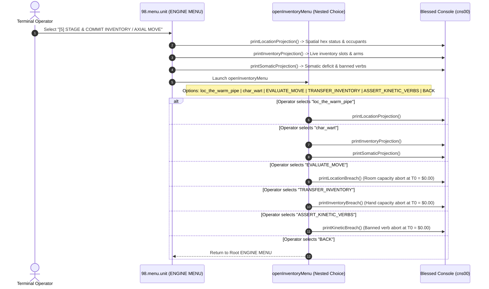

# [5] STAGE & COMMIT INVENTORY / AXIAL MOVE

> Documentation for the highlighted terminal menu item in `ENGINE MENU` (`packages/300.engine`).

---

## 1. Overview & Strategic Role

In the Blessed Terminal Cockpit under the **`ENGINE MENU`**, the menu item:

```text
[5] STAGE & COMMIT INVENTORY / AXIAL MOVE
```
*(displayed as `[5] STAGE & COMMIT INVENTORY / AXIAL` in constrained menu viewports)*

orchestrates the **Spatial-Kinetic-Logistical Staging Pipeline** across three primary units:
- [11.movement.unit](file:///d:/trellis/000.series-sower-engine/packages/300.engine/11.movement.unit) (discrete hexagonal axial coordinate math, cubic invariants, traversal costs, locomotion gating).
- [10.location.unit](file:///d:/trellis/000.series-sower-engine/packages/300.engine/10.location.unit) (topological site registry, volumetric room capacity ceilings, portal occlusion).
- [07.inventory.unit](file:///d:/trellis/000.series-sower-engine/packages/300.engine/07.inventory.unit) (hand capacity inequality, item transfer across 4 containment tiers).

In continuous virtual environments, physics calculations often rely on non-deterministic floating-point coordinates. In `series-sower-engine`:
1. **Discrete Non-Euclidean Geometry:** Spatial positions are anchored to integer hexagonal coordinates $(q, r, s)$ governed by the planar cubic invariant $q + r + s = 0$.
2. **Volumetric Saturation:** Locations enforce hard spatial capacity bounds. An overloaded hex rejects entrance immediately.
3. **Locomotion-Gated Traversal:** An entity's biological locomotion tier governs mobility: `LIMPING` doubles movement costs, while `IMMOBILIZED` halts movement completely.
4. **Portal Occlusion:** Portals in `LOCKED` states structurally block transitions between adjacent topological locations.
5. **Directorial Pre-Flight Validation ($T_0 = \$0.00$):** All topological moves and inventory transfers are validated in deterministic local memory before invoking LLMs or appending events to `event_log`.

---

## 2. Dispatch Flow & Sub-Menu Architecture

Selecting option `[5]` in [packages/300.engine/98.menu.unit/buz/00.menu.buzz.ts](file:///d:/trellis/000.series-sower-engine/packages/300.engine/98.menu.unit/buz/00.menu.buzz.ts#L541-L546) triggers a triple projection trace across the Blessed console (`cns00`) and shifts into the nested **Spatial / Entity / Inventory Sub-Menu** (`openInventoryMenu`):



---

## 3. Hexagonal Axial Mathematics (`11.movement.unit`)

Spatial geometry is modeled strictly in discrete hex coordinates codified in [packages/300.engine/11.movement.unit/buz/movement.buzz.ts](file:///d:/trellis/000.series-sower-engine/packages/300.engine/11.movement.unit/buz/movement.buzz.ts):

### 3.1 Planar Cubic Invariant ($q + r + s = 0$)
Every axial coordinate $(q, r)$ deterministically derives its third cubic axis $s$:

$$s = -(q + r) \iff q + r + s = 0$$

- Floats are strictly rejected via `[FLOAT_PROHIBITED]`.
- Non-zero sum triples trigger `[AXIAL_INVARIANT_BREACH]`.

### 3.2 Non-Euclidean Hexagonal Distance Metric
The distance between two hexagonal points $A(q_a, r_a, s_a)$ and $B(q_b, r_b, s_b)$ is computed as:

$$\text{Distance}(A, B) = \max\Big(|q_a - q_b|, \; |r_a - r_b|, \; |s_a - s_b|\Big)$$

**Example from Genesis:**
- `char_bog`: $(10, 2, -12)$
- `char_wart`: $(11, 2, -13)$
- $\text{Distance} = \max(|10 - 11|, |2 - 2|, |-12 - (-13)|) = \max(1, 0, 1) = 1 \text{ hex step}$.

### 3.3 Locomotion-Gated Traversal Costs
Traversal energy costs are calculated based on step count and biological locomotion tier:

$$\text{Cost} = \text{Distance} \times \text{Base Units (100)} \times \text{Tier Multiplier}$$

| Locomotion Tier | Multiplier | Movement Behavior |
| :--- | :---: | :--- |
| **`UNRESTRICTED`** | $1.0\times$ | Standard traversal cost (100 units/hex). |
| **`LIMPING`** | $2.0\times$ | Traversal cost doubled (200 units/hex). |
| **`IMMOBILIZED`** | $\infty$ | Halts movement immediately (`[LOCOMOTION_IMMOBILIZED_BREACH]`). |

---

## 4. Topological Site Registry & Capacity Limits (`10.location.unit`)

Defined in [packages/300.engine/10.location.unit/buz/location.buzz.ts](file:///d:/trellis/000.series-sower-engine/packages/300.engine/10.location.unit/buz/location.buzz.ts):

### 4.1 Volumetric Room Capacity Invariant
Every location has a finite occupant ceiling (`maxOccupancy`):

$$\text{count}(\text{occupants}) + \text{incoming} \le \text{maxOccupancy}$$

- When `loc_the_warm_pipe` holds 2 occupants (`char_bog` and `char_wart`) with `maxOccupancy = 2`, its capacity is **100% SATURATED**.
- Attempting to move a 3rd entity into the hex triggers `[ROOM_CAPACITY_EXCEEDED]` and aborts the move at $T_0 = \$0.00$.

### 4.2 Dynamic Portal Occlusion
Locations connect via named portals (e.g. `hatch_valve_04`) that maintain discrete operational states:
- `OPEN`: Traversal allowed.
- `CLOSED`: Traversal blocked until opened.
- `LOCKED`: Traversal blocked (`[PORTAL_OCCLUDED_BREACH]`) until unlocked.

---

## 5. Logistical Hand Capacity Invariant (`07.inventory.unit`)

Movement and physical interaction are constrained by item containment slots:
- **Held Slot Boundary:**
  $$\text{Held Items} \le \lfloor \text{Arms Available} \rfloor$$
- **Entity Demonstration (`char_wart`):**
  - Wart has only 1 functional arm (`arms_available = 1.0`).
  - He holds `[item_iron_knife]` (1/1 held capacity saturated).
  - Attempting to stage another held item triggers `[HAND_CAPACITY_BREACH]`.

---

## 6. Terminal Console Telemetry (`cns00`)

### 6.1 Triple Projection on Menu Entry
```text
>> [LOCATION PROJECTION] loc_the_warm_pipe (Capacity: 2/2 SATURATED)
>> ACOUSTIC DAMPING : 1,500 cdB | AMBIENT ILLUMINATION: 2,000 bps (0.15 lux)
>> DYNAMIC PORTALS  : hatch_valve_04 [LOCKED]
>> ACTIVE OCCUPANTS : char_bog (10, 2, -12), char_wart (11, 2, -13)
>> ENTITY LIVE ROW  : char_wart [ARMS: 1 | LIMPING | PAIN: 6,000 bps]

>> [INVENTORY PROJECTION] char_wart (Arms Available: 1.0)
>> HELD SLOTS    : [item_iron_knife] (1/1 Capacity Saturated)
>> WORN SLOTS    : { torso: "item_tallow_apron" }
>> SLUNG SLOTS   : [item_scavenged_sack]
>> CACHED SLOTS  : [item_copper_flange, item_iron_pipe]
>> STATUS        : [OK] Hand Capacity Invariant Satisfied

>> [SOMATIC PANOPTICON] char_wart (Gait: LIMPING)
>> OPEN WOUNDS      : [SEVERED_LEFT_ARM]
>> ARMS AVAILABLE   : 1.0 / 2.0
>> BANNED VERBS (9) : BIMANUAL_LIFT, CLIMB, EMBRACE, GRAPPLE_TWO_HANDED, HEAVE, PRY_BILATERAL, SPRINT, VAULT, WRENCH
>> AUDIT STATUS     : [OK] O(1) Set-Intersection Gate Online
>> AVAILABLE ARMS: 1.0 / 2.0 (Trauma: SEVERED_LEFT_ARM)
>> LOCOMOTION    : LIMPING (Pain: 6,000 bps)
>> REFUSAL STRAIN: 8,500 / 10,000 bps [STRAINED - RETALIATION IMMINENT]
```

### 6.2 Directorial Abort Invariant Probes
1. **Selecting `'EVALUATE_MOVE'` (Room Saturation):**
   ```text
   >> [ROOM_CAPACITY_EXCEEDED] Location 'loc_the_warm_pipe' capacity saturated (3/2)
   >> DIRECTORIAL ACTION: Transaction aborted at T0 = $0.00
   ```
2. **Selecting `'TRANSFER_INVENTORY'` (Hand Over-Allocation):**
   ```text
   >> [HAND_CAPACITY_BREACH] Entity char_wart has 1 arm(s) available, cannot hold 2 items!
   >> DIRECTORIAL ACTION: Transaction aborted at T0 = $0.00
   ```
3. **Selecting `'ASSERT_KINETIC_VERBS'` (Anatomical Deficiency):**
   ```text
   >> [SOMATIC_CAPABILITY_BREACH] Actor char_wart attempted banned verb(s): [BIMANUAL_LIFT]
   >> ACTIVE ANATOMICAL DEFICIT: SEVERED_LEFT_ARM (Arms Available: 1.0 / 2.0)
   >> ARMS AVAILABLE: 1.0 / 2.0 | ACTIVE TRAUMA: SEVERED_LEFT_ARM
   >> DIRECTORIAL ACTION: Transaction aborted at T0 = $0.00
   ```

---

## 7. Verification & Automated Test Coverage

The spatial and movement invariants are certified by the following unit test suites:

```bash
# 1. Test axial cubic invariants, non-Euclidean distance, and locomotion gating
npx vitest run packages/300.engine/11.movement.unit/movement.test.ts

# 2. Test topological location registry, capacity gating, and portal states
npx vitest run packages/300.engine/10.location.unit/location.test.ts

# 3. Test hand capacity bounds and logistical transfers
npx vitest run packages/300.engine/07.inventory.unit/inventory.test.ts
```

### Verified Properties:
- Invariant $q + r + s === 0$ holds strictly across all axial calculations.
- Moving into a saturated location triggers `[ROOM_CAPACITY_EXCEEDED]`.
- Traversing through a locked portal triggers `[PORTAL_OCCLUDED_BREACH]`.
- An immobilized actor cannot move (`[LOCOMOTION_IMMOBILIZED_BREACH]`).
- Limping entities incur a $2\times$ traversal penalty.
