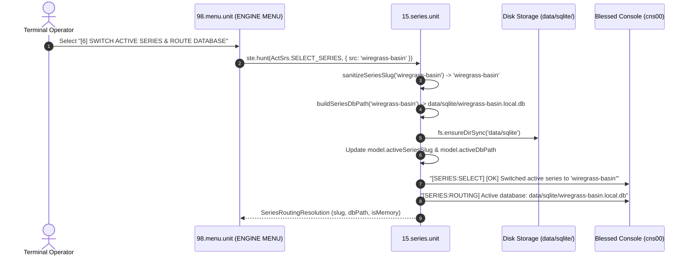

# [6] SWITCH ACTIVE SERIES & ROUTE DATABASE

> Documentation for the highlighted terminal menu item in `ENGINE MENU` (`packages/300.engine`).

---

## 1. Overview & Strategic Role

In the Blessed Terminal Cockpit under the **`ENGINE MENU`**, the menu item:

```text
[6] SWITCH ACTIVE SERIES & ROUTE DATABASE
```
*(displayed as `[6] SWITCH ACTIVE SERIES & ROUTE` in constrained menu viewports)*

manages **Multi-Universe Isolation**, **Slug Sanitization**, and **Dynamic SQLite Database Routing** via [15.series.unit](file:///d:/trellis/000.series-sower-engine/packages/300.engine/15.series.unit).

In multi-storyworld simulation engines, cross-universe contamination is a critical failure mode: characters, historical event streams, and relational debts from one fictional setting (e.g. `under-the-floorboards`) must never leak into another setting (e.g. `wiregrass-basin`). Menu option `[6]` enforces **Strict Namespace Isolation** by:
1. Normalizing raw universe titles into canonical kebab-case slugs (`sanitizeSeriesSlug`).
2. Dynamically mapping the active series to a dedicated, cordoned SQLite database file at `data/sqlite/<slug>.local.db` (or `:memory:`).
3. Switching the engine's active database router without requiring process restarts.
4. Emitting confirmation telemetry to the Blessed console (`cns00`).

---

## 2. Dispatch Flow & Architecture

Selecting option `[6]` in [packages/300.engine/98.menu.unit/buz/00.menu.buzz.ts](file:///d:/trellis/000.series-sower-engine/packages/300.engine/98.menu.unit/buz/00.menu.buzz.ts#L548-L561) switches the active storyworld context:



---

## 3. Series Slug Sanitization Algorithm (`sanitizeSeriesSlug`)

To guarantee that file paths and database namespaces are cross-platform safe (Windows, Linux, macOS) and devoid of command-injection or directory-traversal vulnerabilities, [packages/300.engine/15.series.unit/buz/series.buzz.ts](file:///d:/trellis/000.series-sower-engine/packages/300.engine/15.series.unit/buz/series.buzz.ts#L23-L32) implements strict kebab-case normalization:

```typescript
export const sanitizeSeriesSlug = (raw: string): string => {
    if (!raw || raw.trim().length === 0) return 'default'
    return (
        raw
            .toLowerCase()
            .trim()
            .replace(/[\s_]+/g, '-')
            .replace(/[^a-z0-9-]/g, '')
            .replace(/-+/g, '-')
            .replace(/^-+|-+$/g, '') || 'default'
    )
}
```

### Sanitization Rules & Test Assertions:
| Input String | Normalized Slug | Notes |
| :--- | :--- | :--- |
| `"Under The Floorboards"` | `"under-the-floorboards"` | Spaces converted to hyphens, lowercased. |
| `"Wiregrass_Basin_01!!"` | `"wiregrass-basin-01"` | Punctuation stripped, underscores converted. |
| `""` *(empty string)* | `"default"` | Safe fallback preventing unanchored paths. |
| `"---messy---slug---"` | `"messy-slug"` | Edge hyphens stripped, redundant hyphens collapsed. |

---

## 4. Deterministic Database Path Resolution (`buildSeriesDbPath`)

Governed by [packages/300.engine/15.series.unit/buz/series.buzz.ts](file:///d:/trellis/000.series-sower-engine/packages/300.engine/15.series.unit/buz/series.buzz.ts#L37-L43):

```typescript
export const buildSeriesDbPath = (
    seriesSlug: string,
    isMemory = false,
): string => {
    if (isMemory || seriesSlug === ':memory:' || seriesSlug === 'memory') {
        return ':memory:'
    }
    const cleanSlug = sanitizeSeriesSlug(seriesSlug)
    return path.resolve(
        process.cwd(),
        'data',
        'sqlite',
        `${cleanSlug}.local.db`,
    )
}
```

### Architectural Benefits:
1. **Isolated Storage Inodes:** Each storyworld persists to its own physical SQLite file (`data/sqlite/<slug>.local.db`). Dropping, archiving, or auditing a series never interferes with sibling series.
2. **In-Memory Testing Support:** Passing `isMemory: true` routes operations to `:memory:` without creating disk artifacts during unit tests or ephemeral benchmarks.
3. **Automatic Directory Provisioning:** `fs.ensureDirSync(path.dirname(dbPath))` ensures parent folders exist prior to driver initialization.

---

## 5. Terminal Console Telemetry (`cns00`)

When menu option `[6]` is selected, the cockpit upper console displays the routing transition:

```text
>> [SERIES:SELECT] [OK] Switched active series to 'wiregrass-basin'
>> [SERIES:ROUTING] Active database: data/sqlite/wiregrass-basin.local.db
```

> **Telemetry Architecture Note:**
> All telemetry passes non-blockingly across `global.LIBRARY.hunt('[Console action] Update Console', ...)`. State bus resolution is decoupled from Blessed curses drawing, avoiding deadlock.

---

## 6. Verification & Automated Test Coverage

The series routing and slug sanitization mechanics are verified in [packages/300.engine/15.series.unit/series.test.ts](file:///d:/trellis/000.series-sower-engine/packages/300.engine/15.series.unit/series.test.ts):

```bash
# Run unit test suite for 15.series.unit
npx vitest run packages/300.engine/15.series.unit/series.test.ts
```

### Verified Assertions:
1. **Slug Sanitization:** Verifies string transformation into pure kebab-case ASCII tokens.
2. **Filepath Mapping:** Asserts that database paths map deterministically to `data/sqlite/<slug>.local.db` or `:memory:`.
3. **Active Series Switching:** Verifies that model state (`activeSeriesSlug`, `activeDbPath`, and `availableSeries`) updates atomically upon series selection.
4. **On-Demand Path Resolution:** Confirms that `resolveSeriesDbPath` returns correct `SeriesRoutingResolution` objects synchronously.
