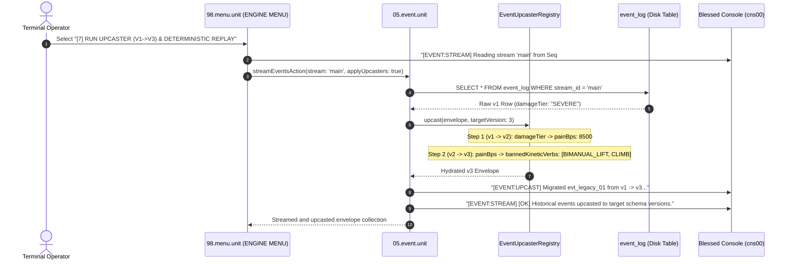

# [7] RUN UPCASTER (V1->V3) & DETERMINISTIC REPLAY

> Documentation for the highlighted terminal menu item in `ENGINE MENU` (`packages/300.engine`).

---

## 1. Overview & Strategic Architecture

In the Blessed Terminal Cockpit under the **`ENGINE MENU`**, the menu item:

```text
[7] RUN UPCASTER (V1->V3) & DETERMINISTIC REPLAY
```
*(displayed as `[7] RUN UPCASTER (V1->V3) &` in constrained menu viewports)*

executes the **Read-Time Event Upcaster Pipeline** and **Historical Deterministic Replay Engine** managed by [05.event.unit](file:///d:/trellis/000.series-sower-engine/packages/300.engine/05.event.unit) and [08.ledger.unit](file:///d:/trellis/000.series-sower-engine/packages/300.engine/08.ledger.unit).

### The Immutability Dilemma in Event Sourcing
In an append-only event ledger:
1. **The Hash Chain is Immutable:** Every event $E_n$ commits a cryptographic digest of its previous event hash ($H_{n-1}$) and the state root ($S_n$). Modifying or running SQL `UPDATE` migrations over historical rows in `event_log` permanently corrupts the hash chain and violates the `trg_event_log_no_update` trigger.
2. **Schemas Inevitably Evolve:** As the simulation engine expands, event schemas evolve (e.g. migrating qualitative string tags like `damageTier: "SEVERE"` into quantitative basis points `painBps: 8500` and semantic masks `bannedKineticVerbs`).

### The Pure Upcasting Solution
Menu option `[7]` demonstrates the engine's architectural solution: **Pure Read-Time Stepwise Upcasting**:
- **On Disk (SQLite):** Historical records remain permanently frozen in their original schema format ($v1$).
- **In Memory (Stream Projection):** When events are streamed from SQLite for replay, the `EventUpcasterRegistry` intercepts each envelope, applies a pure linear migration pipeline ($v1 \to v2 \to v3$), and delivers modern $v3$ envelopes to downstream state reducers with zero disk rewrites.

---

## 2. Dispatch Flow & Architecture

Selecting option `[7]` in [packages/300.engine/98.menu.unit/buz/00.menu.buzz.ts](file:///d:/trellis/000.series-sower-engine/packages/300.engine/98.menu.unit/buz/00.menu.buzz.ts#L563-L580) executes the stream upcaster demo:



---

## 3. Stepwise Upcaster Mechanics (`EventUpcasterRegistry`)

Defined in [packages/300.engine/05.event.unit/event.model.ts](file:///d:/trellis/000.series-sower-engine/packages/300.engine/05.event.unit/event.model.ts#L15-L58), the upcaster registry registers pure transformation functions keyed by `${eventType}:v${fromVersion}`:

### 3.1 Stepwise Migration Pipeline
Upcasting never jumps across multiple versions in a single ad-hoc function. Instead, migrations execute in discrete, composable steps:

$$v_1 \xrightarrow{\;f_{1 \to 2}\;} v_2 \xrightarrow{\;f_{2 \to 3}\;} v_3 \dots \xrightarrow{\;f_{n-1 \to n}\;} v_n$$

```typescript
public upcast<T = unknown>(envelope: any, targetVersion: number): any {
    let currentVersion = envelope.schemaVersion || 1
    let currentEnvelope = { ...envelope }

    while (currentVersion < targetVersion) {
        const key = `${currentEnvelope.eventType || currentEnvelope.type}:v${currentVersion}`
        const fn = this.upcasters.get(key)
        if (!fn) {
            throw new Error(
                `[MISSING_UPCASTER] Cannot migrate ${currentEnvelope.eventType} from v${currentVersion} to v${targetVersion}`,
            )
        }
        currentEnvelope = fn(currentEnvelope)
        currentVersion = currentEnvelope.schemaVersion
    }
    return currentEnvelope
}
```

### 3.2 Concrete Pipeline: `SOMATIC_TRAUMA_APPLIED`

Codified in [packages/300.engine/05.event.unit/buz/event.buzz.ts](file:///d:/trellis/000.series-sower-engine/packages/300.engine/05.event.unit/buz/event.buzz.ts#L36-L82):

#### Step 1: Version 1 $\to$ Version 2 (Qualitative to Quantitative Basis Points)
Legacy systems recorded trauma as vague text tags. Upcaster $v1 \to v2$ maps damage tiers to integer basis points:
- `"MILD"` $\to$ `painBps = 1500`, `refusalStrainBps = 500`
- `"MODERATE"` $\to$ `painBps = 5000`, `refusalStrainBps = 2500`
- `"SEVERE"` $\to$ `painBps = 8500`, `refusalStrainBps = 6000`

#### Step 2: Version 2 $\to$ Version 3 (Basis Points to Kinetic Verb Masks)
Upcaster $v2 \to v3$ analyzes pain and derives the exact anatomical capability restrictions:
- If `painBps >= 5000`: appends `SPRINT` and `VAULT` to `bannedKineticVerbs`.
- If `painBps >= 8000`: appends `BIMANUAL_LIFT` and `CLIMB` to `bannedKineticVerbs`.

---

## 4. Disk Immutability Verification

A foundational security guarantee is that upcasting **never touches the physical SQLite rows**:

```typescript
// Verify SQLite raw data remains completely untouched at v1
const rawRow = dbPort
    .prepare(
        "SELECT schema_version, payload_json FROM event_log WHERE event_id = 'evt_legacy_01'",
    )
    .get()

expect(rawRow.schema_version).toBe(1)
expect(rawRow.payload_json).toContain('SEVERE')
```

- **Hash Chain Preserved:** The original `prev_event_hash` and `state_hash` digests in `event_log` remain 100% valid.
- **Trigger Security:** SQLite triggers `trg_event_log_no_update` and `trg_event_log_no_delete` are never tripped.

---

## 5. Terminal Console Telemetry (`cns00`)

When menu option `[7]` is activated, the cockpit streams the following event migration and replay report:

```text
>> [EVENT:STREAM] Reading stream 'main' from Seq #1...
>> [EVENT:UPCAST] Migrated evt_legacy_01 from v1 -> v3 (pain_bps: 8500, verbs: BIMANUAL_LIFT, CLIMB)
>> [EVENT:STREAM] [OK] Historical events upcasted to target schema versions.
```

If an unknown event type or unhandled schema step is encountered, the registry fails deterministically:
```text
:: [MISSING_UPCASTER] Cannot migrate UNKNOWN_CUSTOM_EVENT from v1 to v2
```

---

## 6. Verification & Automated Test Coverage

The upcaster registry and read-time migration pipeline are validated in [packages/300.engine/05.event.unit/event.test.ts](file:///d:/trellis/000.series-sower-engine/packages/300.engine/05.event.unit/event.test.ts):

```bash
# Run unit tests for 05.event.unit
npx vitest run packages/300.engine/05.event.unit/event.test.ts
```

### Verified Assertions:
1. **Pure Stepwise Upcasting:** Verifies that a $v1$ envelope sequentially upcasts through $v2$ to $v3$, properly synthesizing `painBps: 8500` and `bannedKineticVerbs: ['BIMANUAL_LIFT', 'CLIMB']`.
2. **Missing Upcaster Detection:** Asserts that an unregistered intermediate step throws `[MISSING_UPCASTER]`.
3. **Read-Time Streaming:** Asserts that `streamEventsAction` with `applyUpcasters: true` yields $v3$ envelopes in memory while disk rows remain at $v1$.
4. **Append-Only Immutability:** Confirms that reading and migrating historical events performs 0 writes to the SQLite database.
