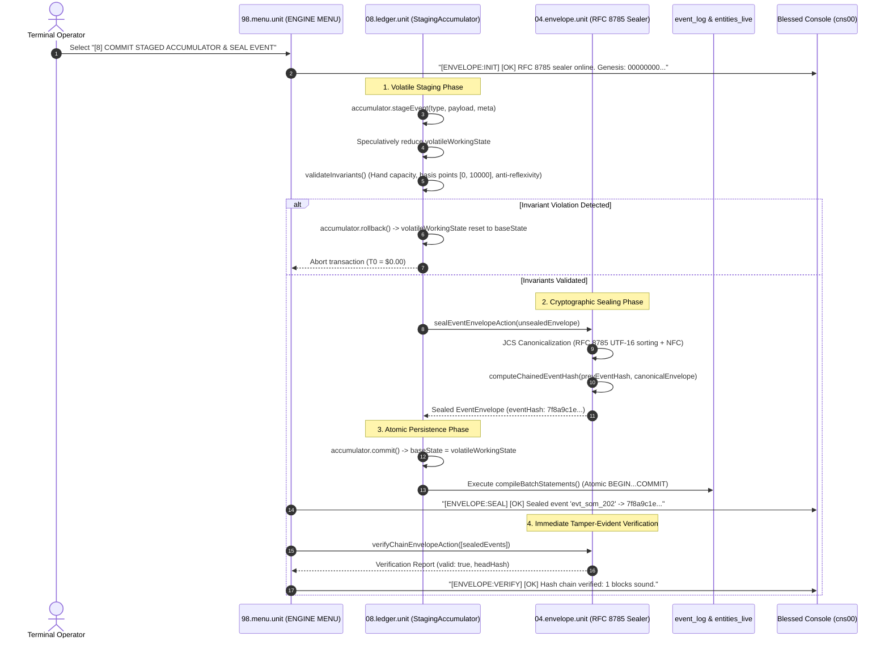

# [8] COMMIT STAGED ACCUMULATOR & SEAL EVENT

> Documentation for the highlighted terminal menu item in `ENGINE MENU` (`packages/300.engine`).

---

## 1. Overview & Strategic Role

In the Blessed Terminal Cockpit under the **`ENGINE MENU`**, the menu item:

```text
[8] COMMIT STAGED ACCUMULATOR & SEAL EVENT
```
*(displayed as `[8] COMMIT STAGED ACCUMULATOR & SEAL` in constrained menu viewports)*

demonstrates the **Two-Phase Volatile Staging Pipeline** and **RFC 8785 Cryptographic Envelope Sealer** coordinated between:
- [08.ledger.unit](file:///d:/trellis/000.series-sower-engine/packages/300.engine/08.ledger.unit) (`StagingAccumulator`, volatile memory reduction, pre-commit invariant gates).
- [04.envelope.unit](file:///d:/trellis/000.series-sower-engine/packages/300.engine/04.envelope.unit) (RFC 8785 Canonical JSON, SHA-256 recursive hash chaining, tamper-evident verification).

### The Dual Guarantees:
1. **Volatile Staging & Atomic Invariant Gate:** State mutations are never written directly to SQLite one by one. Instead, candidate events are staged speculatively into a volatile RAM accumulator. Before any byte is persisted, the accumulator audits all biological, spatial, and relational invariants. If any invariant is violated, the accumulator rolls back cleanly in memory with **zero disk corruption and zero LLM cost ($T_0 = \$0.00$)**.
2. **Cryptographic Sealing & Proof Chaining:** Once validated, each event envelope is sealed into an unbroken, tamper-evident SHA-256 hash chain anchored to `GENESIS_HASH_64` ($0^{64}$) and canonicalized via RFC 8785 JSON Canonicalization Scheme (JCS).

---

## 2. Dispatch Flow & Architecture

Selecting option `[8]` in [packages/300.engine/98.menu.unit/buz/00.menu.buzz.ts](file:///d:/trellis/000.series-sower-engine/packages/300.engine/98.menu.unit/buz/00.menu.buzz.ts#L463-L479) demonstrates the complete staging, sealing, and chain audit sequence:



---

## 3. The Staging Accumulator Pattern (`08.ledger.unit`)

Codified in [packages/300.engine/08.ledger.unit/ledger.model.ts](file:///d:/trellis/000.series-sower-engine/packages/300.engine/08.ledger.unit/ledger.model.ts#L14-L155):

### 3.1 State Isolation Mechanics
The `StagingAccumulator` maintains strict separation between verified truth and speculative state:
- `baseState`: The immutable starting snapshot matching persistent SQLite storage.
- `volatileWorkingState`: A deep clone of the base state that absorbs pending event reductions in RAM.
- `pendingEvents`: Queue of sealed event envelopes awaiting persistence.
- `lastHash`: Tracks the tip of the hash chain across pending events.

### 3.2 Pre-Commit Invariant Gate (`validateInvariants`)
Before any staged batch can be committed to disk, `validateInvariants` audits the volatile state:

```typescript
public validateInvariants(): InvariantValidationResult {
  const violations: string[] = [];
  const entities = this.volatileWorkingState.entities;

  // 1. Hand Capacity Invariant
  for (const [id, ent] of Object.entries(entities)) {
    if (ent.held_items.length > ent.arms_available) {
      violations.push(`[HAND_CAPACITY_BREACH]: Entity ${id} holds ${ent.held_items.length} items with only ${ent.arms_available} arm(s)`);
    }
    // 2. Basis Point Bound Invariant [0, 10000]
    if (ent.fatigue_bps < 0 || ent.fatigue_bps > 10000) violations.push(`[BASIS_POINTS_BREACH]: Entity ${id} fatigue out of bounds`);
    if (ent.pain_bps < 0 || ent.pain_bps > 10000) violations.push(`[BASIS_POINTS_BREACH]: Entity ${id} pain out of bounds`);
    if (ent.refusal_strain_bps < 0 || ent.refusal_strain_bps > 10000) violations.push(`[BASIS_POINTS_BREACH]: Entity ${id} refusal strain out of bounds`);
  }

  // 3. Social Relation Anti-Reflexivity Invariant
  for (const [key, str] of Object.entries(this.volatileWorkingState.strings)) {
    if (str.holder_id === str.debtor_id) {
      violations.push(`[ANTI_REFLEXIVITY_BREACH]: String relation ${key} has identical holder and debtor`);
    }
  }

  return { valid: violations.length === 0, violations };
}
```

### 3.3 Zero-Cost Rollback vs. Atomic Commit
- **`rollback()`:** Discards `volatileWorkingState` and reinstates `baseState` in $O(1)$ time without SQLite locks or disk writes.
- **`commit()`:** Asserts `valid === true`, promotes `volatileWorkingState` to `baseState`, clears `pendingEvents`, and generates atomic batch SQL statements (`compileBatchStatements`) for `event_log` and `entities_live`.

---

## 4. RFC 8785 Canonical JCS & Cryptographic Sealing (`04.envelope.unit`)

Defined in [packages/300.engine/04.envelope.unit/buz/envelope.buzz.ts](file:///d:/trellis/000.series-sower-engine/packages/300.engine/04.envelope.unit/buz/envelope.buzz.ts):

### 4.1 Canonical JCS Serialization (`canonicalizeJson`)
Standard `JSON.stringify()` is non-deterministic: key order depends on insertion sequence, and float formatting differs across JavaScript runtimes. The RFC 8785 implementation guarantees:
1. **Lexicographical Key Sorting:** Object keys are sorted strictly by UTF-16 code units.
2. **Unicode Normalization:** All string literals normalize to Unicode Normalization Form C (`NFC`).
3. **Number Validation:** `NaN` and `Infinity` immediately throw `TypeError`.

```typescript
export function canonicalizeJson(obj: unknown): string {
    // RFC 8785 recursive key-sorting & NFC normalization
}
```

### 4.2 Recursive Event Hash Chaining (`computeChainedEventHash`)
Each event envelope is cryptographically chained to its predecessor:

$$\text{EventHash}_n = \text{SHA-256}\Big(\text{EventHash}_{n-1} \;\|\; \text{JCS}(\text{UnsealedEnvelope}_n)\Big)$$

Where:
- $\text{EventHash}_0 = \texttt{0000000000000000000000000000000000000000000000000000000000000000}$ (`GENESIS_HASH_64`).
- `UnsealedEnvelope` contains the event metadata, payload, `stateHash`, and the **Spatial Audit Quadruple** (`topologyHash`, `overlayHash`, `queryHash`, `receiptHash`).

### 4.3 Tamper-Evident Chain Verification (`verifyChainEnvelopeAction`)
Replays an array of envelopes and verifies hash continuity:
- If an adversary modifies a single byte in `payload_json` or changes `sequence_id`, the recalculated hash diverges immediately.
- The verification fails with `[HASH_TAMPER_DETECTED]` and reports the exact `failedIndex`.

---

## 5. Terminal Console Telemetry (`cns00`)

When menu option `[8]` is triggered, the upper log console displays the confirmation trace:

```text
>> [ENVELOPE:INIT] [OK] RFC 8785 sealer online. Genesis: 00000000...
>> [ENVELOPE:SEAL] [OK] Sealed event 'evt_som_202' -> 7f8a9c1e...
>> [ENVELOPE:VERIFY] [OK] Hash chain verified: 1 blocks sound.
```

---

## 6. Verification & Automated Test Coverage

The volatile staging accumulator and cryptographic envelope sealer are certified in:

```bash
# 1. Run RFC 8785 JCS, hash chaining, and tamper-detection unit tests
npx vitest run packages/300.engine/04.envelope.unit/envelope.test.ts

# 2. Run StagingAccumulator invariant gating, rollback, and commit tests
npx vitest run packages/300.engine/08.ledger.unit/ledger.test.ts
```

### Key Verified Invariants:
1. **JCS Key Independence:** `{ z: 1, a: 2 }` and `{ a: 2, z: 1 }` produce identical SHA-256 digests.
2. **Unicode Parity:** NFD and NFC representations produce identical canonical strings.
3. **Speculative Rollback:** Breached invariants leave `baseState` completely untouched.
4. **Tamper Rejection:** Modified payload values trigger `HASH_TAMPER_DETECTED` during chain verification.
