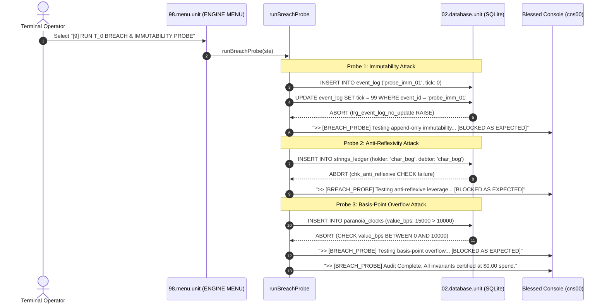

# [9] RUN T_0 BREACH & IMMUTABILITY PROBE

> Documentation for the highlighted terminal menu item in `ENGINE MENU` (`packages/300.engine`).

---

## 1. Overview & Strategic Role

In the Blessed Terminal Cockpit under the **`ENGINE MENU`**, the menu item:

```text
[9] RUN T_0 BREACH & IMMUTABILITY PROBE
```
*(displayed as `[9] RUN T_0 BREACH & IMMUTABILITY` in constrained menu viewports)*

executes an **Adversarial Invariant Stress Test** directly against the active SQLite persistence layer (`02.database.unit`).

Rather than trusting that database triggers, column constraints, and schema invariants are functioning, option `[9]` actively launches simulated attacks against the database to confirm that:
1. **Append-Only Immutability:** Historical event records in `event_log` can never be mutated or deleted.
2. **Relational Integrity:** Inter-actor leverage strings in `strings_ledger` cannot become self-reflexive (`holder_id != debtor_id`).
3. **Mathematical Boundaries:** Pressure meters in `paranoia_clocks` cannot overflow beyond 10,000 basis points ($100.00\%$) or underflow below 0.
4. **Zero Token Cost ($T_0 = \$0.00$):** All invalid actions are halted at the database engine level in under five milliseconds without consuming LLM inference tokens or invoking remote cloud isolates.

---

## 2. Dispatch Flow & Architecture

Selecting option `[9]` in [packages/300.engine/98.menu.unit/buz/00.menu.buzz.ts](file:///d:/trellis/000.series-sower-engine/packages/300.engine/98.menu.unit/buz/00.menu.buzz.ts#L459-L461) triggers `runBreachProbe(ste)`:



---

## 3. The Three Adversarial Invariant Probes

Governed by [packages/300.engine/98.menu.unit/buz/00.menu.buzz.ts](file:///d:/trellis/000.series-sower-engine/packages/300.engine/98.menu.unit/buz/00.menu.buzz.ts#L45-L131):

### 3.1 Probe 1: Append-Only Immutability (`event_log`)
- **Vulnerability Targeted:** Historical revisionism or malicious state rewrites.
- **SQL Attack Executed:**
  ```sql
  INSERT INTO event_log (
    event_id, stream_id, tick, event_type, seed, payload_json,
    prev_event_hash, state_hash, timestamp_ms
  ) VALUES (
    'probe_imm_01', 'main', 0, 'PROBE', '0', '{}',
    '0000000000000000000000000000000000000000000000000000000000000000',
    '0000000000000000000000000000000000000000000000000000000000000000',
    1000
  ) ON CONFLICT(event_id) DO NOTHING;

  -- The adversarial mutation attempt:
  UPDATE event_log SET tick = 99 WHERE event_id = 'probe_imm_01';
  ```
- **Defense Mechanism:** SQLite Trigger `trg_event_log_no_update`:
  ```sql
  CREATE TRIGGER IF NOT EXISTS trg_event_log_no_update
  BEFORE UPDATE ON event_log
  FOR EACH ROW
  BEGIN
    SELECT RAISE(ABORT, 'IMMUTABILITY_VIOLATION: event_log is strictly append-only');
  END;
  ```
- **Verification Result:** The `UPDATE` statement is rejected with `IMMUTABILITY_VIOLATION`.

### 3.2 Probe 2: Anti-Reflexive Leverage (`strings_ledger`)
- **Vulnerability Targeted:** An actor holding leverage or social debt over themselves.
- **SQL Attack Executed:**
  ```sql
  INSERT INTO strings_ledger (
    relation_id, holder_id, debtor_id, weight_bps, strings_count, updated_at_ms
  ) VALUES (
    'probe_rel_01', 'char_bog', 'char_bog', 5000, 1, 1000
  );
  ```
- **Defense Mechanism:** Table constraint `chk_anti_reflexive`:
  ```sql
  CONSTRAINT chk_anti_reflexive CHECK (holder_id != debtor_id)
  ```
- **Verification Result:** SQLite check constraint halts the insert immediately.

### 3.3 Probe 3: Basis-Point Overflow (`paranoia_clocks`)
- **Vulnerability Targeted:** Integer overflow or corrupt metrics exceeding 100.00% ($10,000 \text{ bps}$).
- **SQL Attack Executed:**
  ```sql
  INSERT INTO paranoia_clocks (
    clock_id, entity_id, clock_name, value_bps, threshold_bps, updated_at_ms
  ) VALUES (
    'probe_clk_01', 'char_wart', 'probe_clock', 15000, 8000, 1000
  );
  ```
- **Defense Mechanism:** Column range check:
  ```sql
  CHECK (value_bps BETWEEN 0 AND 10000)
  ```
- **Verification Result:** The $15,000 \text{ bps}$ insertion is rejected.

---

## 4. The Zero-Cost Abort Invariant ($T_0 = \$0.00$)

In generative AI and simulation workflows, allowing invalid actions to reach an LLM costs money, time, and compute:
1. An LLM is queried to generate narrative dialogue or action resolutions for an impossible action (e.g. holding 3 items with 1 arm or mutating historical logs).
2. The system eventually crashes or corrupts down the line, wasting tokens.

`series-sower-engine` establishes **Structural Gate Immunity**:
- Invariants are enforced at the dialect-pure SQLite schema layer and synchronous TypeScript gates.
- Invalid requests fail in $< 2\text{ms}$ with zero API calls.
- Total token expenditure on invalid operations is guaranteed to be:

$$T_0 = \$0.00$$

---

## 5. Terminal Console Telemetry (`cns00`)

When menu option `[9]` is executed in the cockpit, the upper log console prints the complete probe output:

```text
>> [BREACH_PROBE] Testing append-only immutability... [BLOCKED AS EXPECTED]
>> [BREACH_PROBE] Testing anti-reflexive leverage... [BLOCKED AS EXPECTED]
>> [BREACH_PROBE] Testing basis-point overflow... [BLOCKED AS EXPECTED]
>> [BREACH_PROBE] Audit Complete: All invariants certified at $0.00 spend.
```

If any trigger or constraint had failed, the probe would report an adversarial alert:
```text
:: [BREACH_PROBE] Testing append-only immutability... [FAILED: MUTATION ALLOWED]
```

---

## 6. Verification & Automated Test Coverage

This behavior corresponds directly to the test specifications in [packages/300.engine/02.database.unit/database.test.ts](file:///d:/trellis/000.series-sower-engine/packages/300.engine/02.database.unit/database.test.ts):

```bash
# Run unit tests verifying SQLite triggers and check constraints
npx vitest run packages/300.engine/02.database.unit/database.test.ts
```

### Verified Properties:
- `trg_event_log_no_update` triggers abort on all `UPDATE` queries.
- `trg_event_log_no_delete` triggers abort on all `DELETE` queries.
- Anti-reflexive constraints block `holder_id == debtor_id` and `instigator_id == victim_id`.
- Range checks clamp basis points strictly within $[0, 10000]$.
- `PRAGMA integrity_check` returns `ok`.
